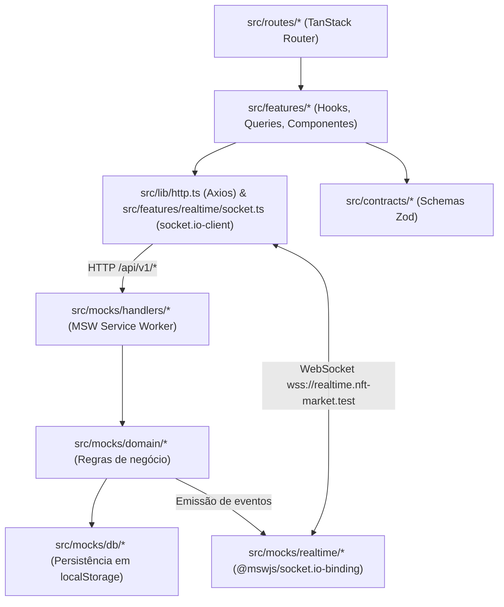

# Arquitetura — Kurio NFT Marketplace

## 1. Camadas e fluxo de dados

A aplicação executa inteiramente no navegador, separada da camada de simulação pela fronteira de rede (`fetch`/`XMLHttpRequest` interceptados pelo Service Worker do MSW e `WebSocket` interceptado por patch do construtor global).

Regras de dependência aplicadas via ESLint (`no-restricted-imports`):

- `axios` só é importado em `src/lib/http.ts`, a instância única.
- `src/routes/`, `src/components/` e `src/features/*/components|hooks/` não importam `axios` nem `@/lib/http`: os dados chegam pelos hooks de `src/features/*/queries.ts`, que usam `src/features/*/api.ts`.
- O código da aplicação não importa nada de `src/mocks/`; o único acesso é o `import('./mocks/browser')` dinâmico em `src/main.tsx`.
- `src/mocks/` só importa de `src/contracts/` e `src/lib/eth.ts`, além das bibliotecas.

A direção `routes/` → `features/` → `lib/`, `contracts/` e `components/` é convenção do projeto, sem trava de lint.

### Ordem de boot no cliente

O pacote `engine.io-client` captura a referência `globalThis.WebSocket` no momento em que o módulo é avaliado. Para evitar que o cliente Socket.IO guarde o construtor nativo antes de o MSW aplicar o patch de WebSocket, `src/main.tsx` não possui imports estáticos da aplicação: primeiro aguarda `startMocks()` (`worker.start()`) e só depois importa `src/app/render.tsx`.

## 2. Contratos REST

Os schemas Zod em `src/contracts/` são compartilhados entre o cliente HTTP e os handlers do MSW. Esta seção será expandida na Fase 1 com a tabela completa de endpoints, cabeçalhos e códigos de erro.

## 3. Eventos Socket.IO

Documentação detalhada de envelope, deduplicação por `eventId`, controle de versão monotônica por recurso e isolamento por `userId` será preenchida na Fase 7.

## 4. Transporte dos mocks e limitações

- **REST:** interceptado via Service Worker (`public/mockServiceWorker.js`).
- **WebSocket:** interceptado no mesmo processo da aba via `@mswjs/socket.io-binding`. O transporte do `socket.io-client` é restrito a `['websocket']`, pois o MSW não intercepta o long-polling HTTP do Engine.IO.

## 5. Política de sessão

A ser detalhada na Fase 5 (token opaco com expiração, retomada de rota após `SESSION_EXPIRED`, limpeza de cache privado no logout e na troca de usuário).

## 6. Estado do carrinho

A ser detalhado na Fase 6 (carrinho anônimo via `X-Guest-Cart-Id`, mesclagem no login, cupons e cotação como única referência de valores para o pedido).

## 7. Estratégia de cache, retries e sincronização

Configuração base do `QueryClient` em `src/app/query-client.ts`:

- `staleTime` padrão de 30 s.
- Retries limitados a 2 tentativas apenas quando `ApiError.retryable === true` (erros de rede, timeout, HTTP 429, 500 e 503), com backoff exponencial `min(500 * 2^attempt, 4000)` ms.
- Mutations não executam retry automático.

## 8. Reconciliação REST e Socket.IO

A ser detalhada nas Fases 7 e 8.

## 9. Idempotência de pedidos

A ser detalhada na Fase 8 (`Idempotency-Key` persistida por tentativa de checkout em `localStorage`).

## 10. Registro de decisões

| Decisão                                                  | Alternativas avaliadas                       | Motivo da escolha                                                                                                                                                                                                               |
| -------------------------------------------------------- | -------------------------------------------- | ------------------------------------------------------------------------------------------------------------------------------------------------------------------------------------------------------------------------------- |
| Vite 8 + npm com `package-lock.json`                     | pnpm / Bun                                   | Compatibilidade direta na Vercel e no ambiente de avaliação sem necessidade de habilitar Corepack                                                                                                                               |
| TypeScript fixado em `~6.0.3`                            | `typescript@latest` (7.0)                    | O `typescript-eslint` 8.x exige `<6.1.0`; configuração usa `paths` sem `baseUrl`                                                                                                                                                |
| MSW fixado em `^2.15.0`                                  | `msw@latest` (3.0)                           | O `@mswjs/socket.io-binding` 0.2.0 depende da API de eventos de conexão do MSW 2.x                                                                                                                                              |
| ESLint fixado em `^9.39.0`                               | `eslint@latest` (10.x)                       | Compatibilidade de peer dependency com `eslint-plugin-jsx-a11y` 6.10.2                                                                                                                                                          |
| Validação de search params com Zod 4 direto              | `@tanstack/zod-adapter`                      | O TanStack Router suporta Standard Schema nativamente com Zod 4, dispensando adaptador externo                                                                                                                                  |
| Fonte `Roboto Mono Variable` auto-hospedada em `/fonts/` | Google Fonts CDN ou import CSS do Fontsource | Evita conexão externa no LCP e mantém caminho fixo sem hash para `<link rel="preload">` no `index.html`, acompanhado de `@font-face` de fallback com métricas ajustadas (`ascent-override: 104.79%`, `descent-override: 27.1%`) |
| `src/routeTree.gen.ts` versionado no Git                 | Gerar apenas em build/dev                    | Permite que `npm run typecheck` (`tsc -b`) passe imediatamente após `npm ci` num checkout limpo                                                                                                                                 |
| `.env` versionado com padrões públicos da simulação      | `.env.example` com cópia manual              | Não há segredos no projeto; versionar `.env` (ignorando `.env.local` no `.gitignore`) garante que `npm ci && npm run ci` e o deploy na Vercel funcionem sem etapa manual                                                        |

## 11. Decisões de UX

- Estados não desenhados no Figma (skeletons, estados vazios, erro de rota e 404) seguem a paleta escura Kurio (`#140D0A`, `#241612`, `#D28A4C`) e a tipografia Roboto Mono.
- Abaixo de `1024px` (`lg`), a interface adota a composição mobile; a partir de `1024px`, a composição desktop de 1200 px.

## 12. Desvios do Figma e ajustes de acessibilidade

| Tela / Elemento                      | No Figma                                    | Na implementação                                                               | Motivo                                                                          |
| ------------------------------------ | ------------------------------------------- | ------------------------------------------------------------------------------ | ------------------------------------------------------------------------------- |
| Borda de inputs, selects e textareas | `#3F2319` (contraste 1,3:1 sobre `#241612`) | Token `--kurio-field` (`#8A6648`, contraste 3,4:1 sobre `#241612`)             | Atender ao contraste mínimo de 3:1 para componentes de formulário (WCAG 1.4.11) |
| Botão "Aplicar" do cupom mobile      | Texto claro sobre gradiente (2,5:1)         | Fundo sólido `bg-primary` (`#D28A4C`) com texto `text-ink` (`#140D0A`, 6,85:1) | Garantir contraste superior a 4,5:1                                             |

## 13. Assets e imagens

As quatro artes principais (`emerald.png`, `nomad.png`, `baron.png` e `golden.png`) foram exportadas do Figma em PNG 4x (1000×1000), a partir dos nós `4:137`, `4:162`, `4:164` e `4:286`, e organizadas em `assets/figma/`. O script `scripts/build-assets.mjs` processa cada arte com `sharp` para gerar quatro vistas quadradas (inteira, rosto, detalhe e moldura sobre `#241612`) nos formatos AVIF e WebP em 320, 640 e 960 px dentro de `public/images/nfts/`, com as dimensões em `manifest.json`. O script recusa PNG com menos de 960 px de lado, para nenhuma variante sair ampliada.

## 14. Limitações conhecidas

- Como o servidor simulado MSW + Socket.IO roda no contexto da aba, o banco em `localStorage` é sincronizado entre abas pelo evento `storage`, mas eventos WebSocket são emitidos para as conexões da aba que originou a mutação.
