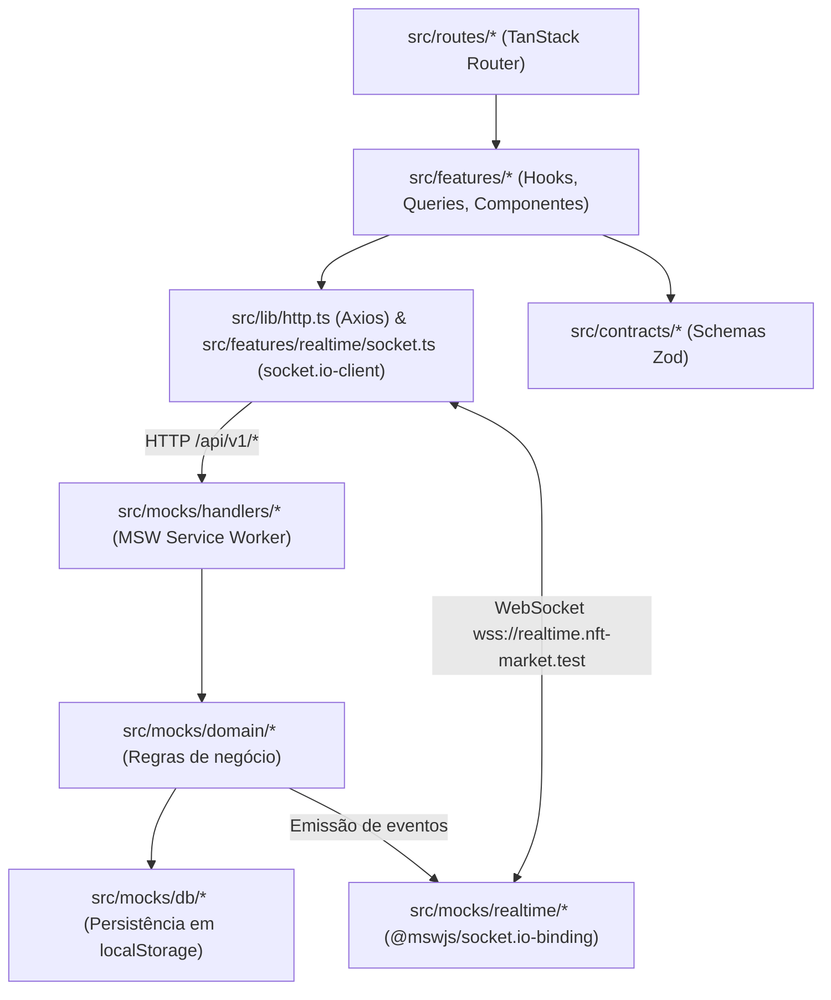

# Arquitetura — Kurio NFT Marketplace

## 1. Camadas e fluxo de dados

A aplicação executa inteiramente no navegador, separada da camada de simulação pela fronteira de rede (`fetch`/`XMLHttpRequest` interceptados pelo Service Worker do MSW e `WebSocket` interceptado por patch do construtor global).



Regras de dependência aplicadas via ESLint (`no-restricted-imports`):

- `src/routes/` consome `src/features/`, `src/components/`, `src/lib/` e `src/contracts/`.
- Componentes nunca importam Axios diretamente; toda comunicação HTTP passa por `src/features/*/api.ts` e `src/features/*/queries.ts`.
- O código da aplicação não importa nada de `src/mocks/`, exceto o `import('./mocks/browser')` dinâmico em `src/main.tsx`.

### Ordem de boot no cliente

O pacote `engine.io-client` captura a referência `globalThis.WebSocket` no momento em que o módulo é avaliado. Para evitar que o cliente Socket.IO guarde o construtor nativo antes de o MSW aplicar o patch de WebSocket, `src/main.tsx` não possui imports estáticos da aplicação: primeiro aguarda `startMocks()` (`worker.start()`) e só depois importa `src/app/render.tsx`.

## 2. Contratos REST

Todos os schemas de entrada e saída estão centralizados em `src/contracts/` e são validados com `Schema.parse()` tanto nos handlers do MSW (`src/mocks/handlers/index.ts`) quanto no cliente HTTP.

### Cabeçalhos padronizados

- `Authorization: Bearer <token>`: sessão autenticada.
- `X-Guest-Cart-Id`: identificador do carrinho anônimo persistido no navegador para visitantes.
- `X-Request-Id`: UUID gerado pelo interceptor de request do Axios e ecoado pelo servidor simulado em todas as respostas.
- `Idempotency-Key`: UUID obrigatório em `POST /api/v1/orders` para impedir compras duplicadas em retries após timeout ou cliques repetidos.

### Tabela de endpoints (`/api/v1`)

| Método e rota                    | Auth     | Entrada                                                                                          | Resposta de sucesso                                      | Códigos de erro principais                                                                                 |
| -------------------------------- | -------- | ------------------------------------------------------------------------------------------------ | -------------------------------------------------------- | ---------------------------------------------------------------------------------------------------------- |
| `POST /auth/register`            | Não      | `{ username, email, password }`                                                                  | `201 AuthResponse`                                       | `409 EMAIL_TAKEN`, `409 USERNAME_TAKEN`, `422 VALIDATION_FAILED`                                           |
| `POST /auth/login`               | Não      | `{ email, password }`                                                                            | `200 AuthResponse`                                       | `401 INVALID_CREDENTIALS`, `422 VALIDATION_FAILED`                                                         |
| `GET /auth/session`              | Sim      | —                                                                                                | `200 AuthResponse`                                       | `401 UNAUTHENTICATED`, `401 SESSION_EXPIRED`                                                               |
| `POST /auth/logout`              | Sim      | —                                                                                                | `204 No Content`                                         | —                                                                                                          |
| `GET /nfts`                      | Não      | Query: `q, collection, category, network, tab, minPrice, maxPrice, status, sort, page, pageSize` | `200 NftListResponse`                                    | `500 INTERNAL`, `503 UNAVAILABLE`                                                                          |
| `GET /nfts/featured`             | Não      | —                                                                                                | `200 FeaturedNftsResponse`                               | `500 INTERNAL`                                                                                             |
| `GET /nfts/:id`                  | Não      | —                                                                                                | `200 Nft`                                                | `404 NOT_FOUND`                                                                                            |
| `GET /me/favorites`              | Sim      | —                                                                                                | `200 FavoritesResponse`                                  | `401 UNAUTHENTICATED`                                                                                      |
| `PUT /me/favorites/:nftId`       | Sim      | —                                                                                                | `204 No Content`                                         | `401 UNAUTHENTICATED`, `404 NOT_FOUND`                                                                     |
| `DELETE /me/favorites/:nftId`    | Sim      | —                                                                                                | `204 No Content`                                         | `401 UNAUTHENTICATED`, `404 NOT_FOUND`                                                                     |
| `GET /cart`                      | Opcional | —                                                                                                | `200 Cart`                                               | —                                                                                                          |
| `POST /cart/items`               | Opcional | `{ nftId, editionId, quantity }`                                                                 | `200 Cart`                                               | `404 NOT_FOUND`, `409 AVAILABILITY_CONFLICT`                                                               |
| `PATCH /cart/items/:itemId`      | Opcional | `{ quantity }`                                                                                   | `200 Cart`                                               | `404 NOT_FOUND`, `409 AVAILABILITY_CONFLICT`                                                               |
| `DELETE /cart/items/:itemId`     | Opcional | —                                                                                                | `200 Cart`                                               | `404 NOT_FOUND`                                                                                            |
| `PUT /cart/coupon`               | Opcional | `{ code }`                                                                                       | `200 Cart`                                               | `422 COUPON_INVALID`, `422 COUPON_EXPIRED`                                                                 |
| `DELETE /cart/coupon`            | Opcional | —                                                                                                | `200 Cart`                                               | —                                                                                                          |
| `POST /cart/merge`               | Sim      | `{ guestCartId }`                                                                                | `200 MergeCartResponse`                                  | `401 UNAUTHENTICATED`                                                                                      |
| `POST /quotes`                   | Opcional | `{ network }`                                                                                    | `200 Quote`                                              | `409 BAD_REQUEST` (carrinho vazio)                                                                         |
| `POST /wallet-connections`       | Sim      | `{ walletId, network, provider }`                                                                | `200 WalletConnectionResponse`                           | `404 NOT_FOUND`, `409 WALLET_REJECTED`                                                                     |
| `DELETE /wallet-connections/:id` | Sim      | —                                                                                                | `204 No Content`                                         | `401 UNAUTHENTICATED`                                                                                      |
| `POST /orders`                   | Sim      | `{ quoteId, connectionId, buyer }` + `Idempotency-Key`                                           | `201 Order` (novo) / `200 Order` (repetição idempotente) | `409 QUOTE_OUTDATED`, `409 AVAILABILITY_CONFLICT`, `409 IDEMPOTENCY_KEY_REUSED`, `409 WALLET_DISCONNECTED` |
| `GET /orders/:id`                | Sim      | —                                                                                                | `200 Order`                                              | `403 FORBIDDEN`, `404 NOT_FOUND`                                                                           |
| `GET /orders?status=pending`     | Sim      | —                                                                                                | `200 PendingOrdersResponse`                              | `401 UNAUTHENTICATED`                                                                                      |
| `GET /me/profile`                | Sim      | —                                                                                                | `200 Profile`                                            | `401 UNAUTHENTICATED`                                                                                      |
| `PATCH /me/profile`              | Sim      | `{ displayName, username, email, ensName, walletNickname }`                                      | `200 Profile`                                            | `409 USERNAME_TAKEN`, `409 EMAIL_TAKEN`, `422 VALIDATION_FAILED`                                           |
| `PUT /me/avatar`                 | Sim      | `multipart/form-data` (`file` ≤ 2 MB; PNG/JPEG/WebP)                                             | `200 AvatarResponse`                                     | `413 FILE_TOO_LARGE`, `415 UNSUPPORTED_MEDIA_TYPE`                                                         |
| `POST /me/password`              | Sim      | `{ currentPassword, newPassword }`                                                               | `204 No Content`                                         | `422 WRONG_PASSWORD`, `422 VALIDATION_FAILED`                                                              |
| `GET /me/wallets`                | Sim      | —                                                                                                | `200 WalletsResponse`                                    | `401 UNAUTHENTICATED`                                                                                      |
| `POST /me/wallets`               | Sim      | `CreateWalletInput`                                                                              | `201 Wallet`                                             | `409 WALLET_CONFLICT`, `422 VALIDATION_FAILED`                                                             |
| `PATCH /me/wallets/:id`          | Sim      | `UpdateWalletInput`                                                                              | `200 Wallet`                                             | `403 FORBIDDEN`, `404 NOT_FOUND`, `409 WALLET_CONFLICT`, `422 VALIDATION_FAILED`                           |

### Envelope de erro e normalização no cliente

O servidor simulado devolve erros no formato:

```json
{
  "error": {
    "code": "VALIDATION_FAILED",
    "message": "Revise os campos destacados.",
    "fieldErrors": { "email": ["E-mail já cadastrado"] },
    "details": {},
    "retryable": false,
    "requestId": "..."
  }
}
```

No cliente (`src/lib/http.ts` e `src/lib/api-error.ts`), qualquer erro (HTTP, falha de conexão do MSW ou timeout do Axios de 8 s) é convertido em `ApiError` com `retryable: true` apenas para falhas de rede, timeout e HTTP 429, 500 e 503.

## 3. Eventos Socket.IO

O servidor simulado em `src/mocks/realtime/server.ts` publica eventos tipados (`RealtimeEventSchema`) sempre que o domínio altera um NFT ou um pedido:

- `nft.updated`: público para todas as conexões ativas; carrega `version` incrementada do NFT, lista de edições (`id`, `price`, `available`) e `priceFrom` recalculado.
- `order.updated`: privado (enviado apenas para conexões cujo token corresponde ao `order.userId`); carrega `version`, `status` (`pending | confirmed | rejected`), `rejectionReason` e `transaction`.

## 4. Transporte dos mocks e limitações

- **REST:** interceptado via Service Worker (`public/mockServiceWorker.js`).
- **WebSocket:** interceptado na mesma aba via `@mswjs/socket.io-binding` (`toSocketIo(connection)`).
- **Keep-alive manual:** o `@mswjs/socket.io-binding` 0.2.0 envia `pingInterval: 25000` e `pingTimeout: 5000` no handshake, mas não dispara pacotes de ping sozinho. O servidor simulado envia `connection.client.send('2')` a cada 20 s e limpa o intervalo no evento `close`, impedindo desconexões por ping timeout aos 30 s.
- **Identificação do usuário no socket:** como o binding confirma o pacote CONNECT antes de expor o payload de autenticação, o mock inspeciona a mensagem Engine.IO/Socket.IO iniciada por `40{...}` para extrair o token e associar a conexão ao `userId`.

## 5. Rotas, proteção e política de sessão

### Árvore de rotas e proteção (`src/routes/*`)

| Rota | Arquivo | Acesso | Comportamento no `beforeLoad` / `loader` |
| --- | --- | --- | --- |
| `__root` | `src/routes/__root.tsx` | Público | Resolve `sessionQueryOptions()` via `ensureQueryData`, renderiza `SiteHeader` (desktop), `SiteFooter`, `MobileTabBar` (mobile), `Announcer`, `Toaster` e `ScenarioPanel` |
| `/` | `src/routes/index.tsx` | Público | Valida search params com `CatalogSearchSchema` (`.catch()` em cada campo) e remove valores padrão da URL via `stripSearchParams` |
| `/nft/$nftId` | `src/routes/nft.$nftId.tsx` | Público | Valida `?edition=`; 404 da API dispara `notFound()` com tela dedicada ("NFT não encontrado") |
| `/cart` | `src/routes/cart.tsx` | Público | Funciona tanto para visitante (`X-Guest-Cart-Id`) quanto para usuário autenticado |
| `/login`, `/register` | `src/routes/login.tsx`, `src/routes/register.tsx` | Visitante | Se já houver sessão ativa, redireciona para `search.redirect` (validado contra open redirect: deve começar com `/` e não com `//`) ou `/` |
| `/_authenticated` | `src/routes/_authenticated.tsx` | Privado | Sem sessão válida, lança `redirect({ to: '/login', search: { redirect: location.href } })` |
| `/checkout` | `src/routes/_authenticated/checkout.tsx` | Privado | Protegida pelo layout `_authenticated` |
| `/orders/$orderId` | `src/routes/_authenticated/orders.$orderId.tsx` | Privado (dono) | Protegida por sessão e validada no servidor pelo `userId` do pedido (`403 FORBIDDEN` para outro usuário) |
| `/profile`, `/wallets`, `/favorites` | `src/routes/_authenticated/{profile,wallets,favorites}.tsx` | Privado | Compartilham a `AccountSidebar` (310 px no desktop e barra de pílulas no mobile) |

### Política de sessão e expiração com retomada

Sessões são representadas por tokens opacos (`kurio-tok-...`) validados pelo servidor simulado em `GET /api/v1/auth/session` durante o boot e a cada requisição privada. No cenário `session-expired`, o TTL é reduzido para 60 s. Quando o interceptor do Axios recebe `401 SESSION_EXPIRED`:

1. Emite o evento `session:expired` (`src/lib/http.ts`), desacoplado do router para evitar dependência circular.
2. O listener em `src/routes/__root.tsx` grava `{ href, reason: 'expired' }` em `sessionStorage` (`nftmkt:resume`), limpa o cache privado (`['user']`, `['cart']`, `['quote']`), zera `['session']` e navega para `/login?redirect=<href>&reason=expired`.
3. O evento `storage` na chave `nftmkt:session` sincroniza login e logout entre abas abertas.
4. _Trade-off documentado:_ em produção com backend dedicado, o token de sessão viveria num cookie `httpOnly; Secure; SameSite=Lax` com rotação de refresh token. Como o Service Worker do MSW no navegador não intercepta nem impõe a flag `httpOnly` em cookies de documento, `localStorage` foi adotado conscientemente na simulação.

## 6. Estado do carrinho e precisão em ETH

- Valores monetários trafegam exclusivamente como strings decimais (`EthAmount`) e todos os cálculos em `src/lib/eth.ts` operam em `bigint` na escala de wei ($10^{18}$), evitando erros de ponto flutuante IEEE-754.
- A cotação (`POST /api/v1/quotes`) é a única fonte de verdade para subtotal, desconto, taxa de rede (`0.016 ETH` na Ethereum, `0.002 ETH` na Polygon e `0.001 ETH` na Solana) e total.
- Na confirmação do pedido (`confirmed`), o servidor subtrai do carrinho apenas os itens e quantidades constantes no snapshot `order.receipt.lines`, preservando qualquer item adicionado após a geração da cotação.

## 7. Estratégia de cache, retries e sincronização

As chaves do TanStack Query são centralizadas em `src/lib/query-keys.ts` (`qk`). Dados privados ficam sempre aninhados sob `['user', userId, ...]`, garantindo isolamento estrutural entre contas: no logout ou na troca de usuário, `removeQueries({ queryKey: ['user'] })`, `removeQueries({ queryKey: ['cart'] })` e `removeQueries({ queryKey: ['quote'] })` eliminam imediatamente qualquer dado do usuário anterior.

Configuração base do `QueryClient` em `src/app/query-client.ts`:

- `staleTime` padrão de 30 s (`Infinity` para `session`, `0` para `cart`, `quote` e `pendingOrders`, `60 s` para `featured`, `favorites`, `profile` e `wallets`).
- Retries limitados a 2 tentativas apenas quando `ApiError.retryable === true` (erros de rede, timeout, HTTP 429, 500 e 503), com backoff exponencial `min(500 * 2^attempt, 4000)` ms.
- Mutations não executam retry automático.

## 8. Reconciliação REST e Socket.IO

A ser detalhada nas Fases 7 e 8 com o `event-ledger` no cliente.

## 9. Idempotência de pedidos

`POST /api/v1/orders` exige o cabeçalho `Idempotency-Key`. O domínio armazena `userId + key -> { bodyHash, orderId, createdAt }` por 24 h:

- Mesma chave + mesmo hash SHA-256 do corpo canônico: retorna HTTP `200` com o pedido existente, sem reservar estoque novamente nem duplicar a compra.
- Mesma chave + corpo diferente: retorna HTTP `409 IDEMPOTENCY_KEY_REUSED`.

## 10. Registro de decisões

| Decisão                                                  | Alternativas avaliadas                       | Motivo da escolha                                                                                                                                                                                                               |
| -------------------------------------------------------- | -------------------------------------------- | ------------------------------------------------------------------------------------------------------------------------------------------------------------------------------------------------------------------------------- |
| Vite 8 + npm com `package-lock.json`                     | pnpm / Bun                                   | Compatibilidade direta na Vercel e no ambiente de avaliação sem necessidade de habilitar Corepack                                                                                                                               |
| TypeScript fixado em `~6.0.3`                            | `typescript@latest` (7.0)                    | O `typescript-eslint` 8.x exige `<6.1.0`; configuração usa `paths` sem `baseUrl`                                                                                                                                                |
| MSW fixado em `^2.15.0`                                  | `msw@latest` (3.0)                           | O `@mswjs/socket.io-binding` 0.2.0 depende da API de eventos de conexão do MSW 2.x                                                                                                                                              |
| ESLint fixado em `^9.39.0`                               | `eslint@latest` (10.x)                       | Compatibilidade de peer dependency com `eslint-plugin-jsx-a11y` 6.10.2                                                                                                                                                          |
| Validação de search params com Zod 4 direto              | `@tanstack/zod-adapter`                      | O TanStack Router suporta Standard Schema nativamente com Zod 4, dispensando adaptador externo                                                                                                                                  |
| Fonte `Roboto Mono Variable` auto-hospedada em `/fonts/` | Google Fonts CDN ou import CSS do Fontsource | Evita conexão externa no LCP e mantém caminho fixo sem hash para `<link rel="preload">` no `index.html`, acompanhado de `@font-face` de fallback com métricas ajustadas (`ascent-override: 104.79%`, `descent-override: 27.1%`) |
| `src/routeTree.gen.ts` versionado no Git                 | Gerar apenas em build/dev                    | Permite que `npm run typecheck` (`tsc -b`) passe imediatamente após `npm ci` num checkout limpo                                                                                                                                 |
| `.env` versionado com padrões públicos da simulação      | `.env.example` com cópia manual              | Não há segredos no projeto; versionar `.env` (ignorando `.env.local` no `.gitignore`) garante que `npm ci && npm run ci` e o deploy na Vercel funcionem sem etapa manual                                                        |
| Hashes PBKDF2 do seed pré-calculados                     | Calcular PBKDF2 no boot inicial              | Mantém a verificação criptográfica real via Web Crypto (`100.000` iterações SHA-256) sem penalizar o TBT/LCP na primeira abertura da página                                                                                     |

## 11. Decisões de UX

- Estados não desenhados no Figma (skeletons, estados vazios, erro de rota e 404) seguem a paleta escura Kurio (`#140D0A`, `#241612`, `#D28A4C`) e a tipografia Roboto Mono.
- Abaixo de `1024px` (`lg`), a interface adota a composição mobile; a partir de `1024px`, a composição desktop de 1200 px.

## 12. Desvios do Figma e ajustes de acessibilidade

| Tela / Elemento                      | No Figma                                    | Na implementação                                                               | Motivo                                                                          |
| ------------------------------------ | ------------------------------------------- | ------------------------------------------------------------------------------ | ------------------------------------------------------------------------------- |
| Borda de inputs, selects e textareas | `#3F2319` (contraste 1,3:1 sobre `#241612`) | Token `--kurio-field` (`#8A6648`, contraste 3,4:1 sobre `#241612`)             | Atender ao contraste mínimo de 3:1 para componentes de formulário (WCAG 1.4.11) |
| Botão "Aplicar" do cupom mobile      | Texto claro sobre gradiente (2,5:1)         | Fundo sólido `bg-primary` (`#D28A4C`) com texto `text-ink` (`#140D0A`, 6,85:1) | Garantir contraste superior a 4,5:1                                             |

## 13. Assets e imagens

As quatro artes principais (`emerald.png`, `nomad.png`, `baron.png` e `golden.png`) foram exportadas dos nós originais do Figma e organizadas em `assets/figma/`. O script `scripts/build-assets.mjs` processa cada arte com `sharp` para gerar quatro vistas quadradas (inteira, rosto, detalhe e moldura sobre `#241612`) nos formatos AVIF e WebP em 320, 640 e 960 px dentro de `public/images/nfts/`.

## 14. Limitações conhecidas

- Como o servidor simulado MSW + Socket.IO roda no contexto da aba, o banco em `localStorage` é sincronizado entre abas pelo evento `storage`, mas eventos WebSocket são emitidos para as conexões da aba que originou a mutação.
