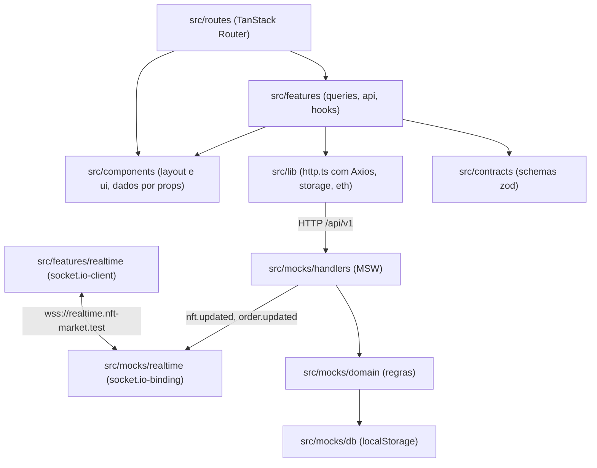

# Arquitetura — Kurio NFT Marketplace

## 1. Camadas e fluxo de dados

A aplicação e o servidor simulado rodam na mesma aba, separados pela rede: o Service Worker do MSW intercepta `fetch` e XHR, e o MSW troca a classe global `WebSocket`. Nenhum componente sabe que a resposta é simulada; trocar o mock por um backend real não mexe na UI.



Hoje `src/features/realtime` tem só o ledger de versões (`event-ledger.ts`); o cliente Socket.IO entra com a camada de tempo real.

Regras de dependência, travadas por `no-restricted-imports` em `eslint.config.js`:

- `axios` só é importado em `src/lib/http.ts`, a instância única, e no teste dela.
- `src/routes/`, `src/components/` e `src/features/*/{components,hooks}/` não importam `@/lib/http`: os dados chegam pelos hooks de `src/features/*/queries.ts`, que usam `src/features/*/api.ts`.
- `src/components/` não importa `features/`, `routes/` nem `app/`. Layout e ui recebem dados por props, e a rota faz a ligação: a raiz passa a sessão, o contador do carrinho e o logout para o header e a tab bar.
- `src/features/` não importa `routes/` nem `app/`. `src/lib/` não importa `app/`, `routes/`, `features/` nem `components/`; de `src/content/` usa só as mensagens de erro do cliente HTTP.
- `src/contracts/` só pode depender de zod e de `src/lib/eth.ts`, porque é compartilhado com o mock e com os testes E2E, que rodam em Node; `src/content/` só reaproveita as mensagens de validação dos contratos.
- O app não importa `src/mocks/`; a única entrada é o `import('./mocks/browser')` dinâmico de `src/main.tsx`. Por sua vez, `src/mocks/` só importa `src/contracts/` e `src/lib/eth.ts`.

### Ordem de boot no cliente

O `engine.io-client` guarda `globalThis.WebSocket` quando o módulo é avaliado. Se o `socket.io-client` carregasse antes do `worker.start()`, o socket escaparia do MSW. Por isso `src/main.tsx` não tem import estático do app: espera `startMocks()` e só então importa `src/app/render.tsx`.

## 2. Contratos REST

A fonte da verdade é `src/contracts/`: um schema zod por corpo e por resposta, usado pelo cliente e pelos handlers do MSW. Os handlers validam a entrada com `readJson` (`src/mocks/handlers/request.ts`) e passam a saída pelo mesmo schema que o cliente usa antes de responder. Valores em ETH trafegam como string decimal (`EthAmountSchema`), e datas como ISO 8601 em UTC (`z.iso.datetime()`; a data das avaliações é só `AAAA-MM-DD`).

### Cabeçalhos

- `Authorization: Bearer <token>`: sessão autenticada.
- `X-Guest-Cart-Id`: id do carrinho de visitante, gerado no cliente e guardado em `localStorage` (`nftmkt:guest-cart-id`).
- `X-Request-Id`: UUID gerado pelo interceptor do Axios e devolvido pelo servidor simulado em toda resposta.
- `Idempotency-Key`: obrigatório em `POST /orders` (seção 9).

### Endpoints (`/api/v1`)

| Método e rota                    | Auth     | Entrada                                                                                          | Sucesso                                     | Erros principais                                                                                                                          |
| -------------------------------- | -------- | ------------------------------------------------------------------------------------------------ | ------------------------------------------- | ----------------------------------------------------------------------------------------------------------------------------------------- |
| `POST /auth/register`            | Não      | `{ username, email, password }`                                                                  | `201 AuthResponse`                          | `409 EMAIL_TAKEN`, `409 USERNAME_TAKEN`, `422 VALIDATION_FAILED`                                                                          |
| `POST /auth/login`               | Não      | `{ email, password }`                                                                            | `200 AuthResponse`                          | `401 INVALID_CREDENTIALS`, `422 VALIDATION_FAILED`                                                                                        |
| `GET /auth/session`              | Sim      | —                                                                                                | `200 AuthResponse`                          | `401 UNAUTHENTICATED`, `401 SESSION_EXPIRED`                                                                                              |
| `POST /auth/logout`              | Sim      | —                                                                                                | `204` (idempotente)                         | —                                                                                                                                         |
| `GET /nfts`                      | Não      | Query: `q, collection, category, network, tab, minPrice, maxPrice, status, sort, page, pageSize` | `200 NftListResponse`                       | `500 INTERNAL`, `503 UNAVAILABLE`                                                                                                         |
| `GET /nfts/featured`             | Não      | —                                                                                                | `200 FeaturedNftsResponse`                  | `500 INTERNAL`                                                                                                                            |
| `GET /nfts/:id`                  | Não      | —                                                                                                | `200 Nft`                                   | `404 NOT_FOUND`                                                                                                                           |
| `GET /me/favorites`              | Sim      | —                                                                                                | `200 FavoritesResponse`                     | `401`                                                                                                                                     |
| `PUT /me/favorites/:nftId`       | Sim      | —                                                                                                | `204` (idempotente)                         | `401`, `404 NOT_FOUND`                                                                                                                    |
| `DELETE /me/favorites/:nftId`    | Sim      | —                                                                                                | `204` (idempotente)                         | `401`, `404 NOT_FOUND`                                                                                                                    |
| `GET /cart`                      | Opcional | —                                                                                                | `200 Cart` (sem `X-Guest-Cart-Id`, cria um) | `401`                                                                                                                                     |
| `POST /cart/items`               | Opcional | `{ nftId, editionId, quantity }`                                                                 | `200 Cart`                                  | `404 NOT_FOUND`, `409 AVAILABILITY_CONFLICT`                                                                                              |
| `PATCH /cart/items/:itemId`      | Opcional | `{ quantity }`                                                                                   | `200 Cart`                                  | `404 NOT_FOUND`, `409 AVAILABILITY_CONFLICT`                                                                                              |
| `DELETE /cart/items/:itemId`     | Opcional | —                                                                                                | `200 Cart`                                  | `404 NOT_FOUND`                                                                                                                           |
| `PUT /cart/coupon`               | Opcional | `{ code }`                                                                                       | `200 Cart`                                  | `422 COUPON_INVALID`, `422 COUPON_EXPIRED`                                                                                                |
| `DELETE /cart/coupon`            | Opcional | —                                                                                                | `200 Cart`                                  | —                                                                                                                                         |
| `POST /cart/merge`               | Sim      | `{ guestCartId }`                                                                                | `200 MergeCartResponse`                     | `401`                                                                                                                                     |
| `POST /quotes`                   | Opcional | `{ network }`                                                                                    | `200 Quote` (problemas em `issues`)         | `409 CART_EMPTY`                                                                                                                          |
| `POST /wallet-connections`       | Sim      | `{ walletId, network, provider }`                                                                | `200 WalletConnectionResponse`              | `404 NOT_FOUND`, `409 WALLET_REJECTED`, `422 VALIDATION_FAILED` (carteira de outra rede)                                                  |
| `DELETE /wallet-connections/:id` | Sim      | —                                                                                                | `204` (idempotente)                         | `403 FORBIDDEN`                                                                                                                           |
| `POST /orders`                   | Sim      | `{ quoteId, connectionId, buyer }` + `Idempotency-Key`                                           | `201 Order` novo; `200 Order` na repetição  | `400 BAD_REQUEST` (sem chave), `409 QUOTE_OUTDATED`, `409 AVAILABILITY_CONFLICT`, `409 IDEMPOTENCY_KEY_REUSED`, `409 WALLET_DISCONNECTED` |
| `GET /orders/:id`                | Sim      | —                                                                                                | `200 Order`                                 | `403 FORBIDDEN`, `404 NOT_FOUND`                                                                                                          |
| `GET /orders?status=pending`     | Sim      | —                                                                                                | `200 PendingOrdersResponse`                 | `400 BAD_REQUEST` (outro `status`)                                                                                                        |
| `GET /me/profile`                | Sim      | —                                                                                                | `200 Profile`                               | `401`                                                                                                                                     |
| `PATCH /me/profile`              | Sim      | `{ displayName, username, email, ensName, walletNickname }`                                      | `200 Profile`                               | `409 USERNAME_TAKEN`, `409 EMAIL_TAKEN`, `422 VALIDATION_FAILED`                                                                          |
| `PUT /me/avatar`                 | Sim      | `multipart/form-data` com `file` (até 2 MB; PNG, JPEG ou WebP)                                   | `200 AvatarResponse`                        | `413 FILE_TOO_LARGE`, `415 UNSUPPORTED_MEDIA_TYPE`, `422 VALIDATION_FAILED` (sem arquivo)                                                 |
| `DELETE /me/avatar`              | Sim      | —                                                                                                | `200 AvatarResponse` com `avatarUrl: null`  | `401`                                                                                                                                     |
| `POST /me/password`              | Sim      | `{ currentPassword, newPassword }`                                                               | `204`                                       | `422 WRONG_PASSWORD`, `422 VALIDATION_FAILED`                                                                                             |
| `GET /me/wallets`                | Sim      | —                                                                                                | `200 WalletsResponse`                       | `401`                                                                                                                                     |
| `POST /me/wallets`               | Sim      | `CreateWalletInput`                                                                              | `201 Wallet`                                | `409 WALLET_CONFLICT`, `422 VALIDATION_FAILED`                                                                                            |
| `PATCH /me/wallets/:id`          | Sim      | `UpdateWalletInput`                                                                              | `200 Wallet`                                | `403 FORBIDDEN`, `404 NOT_FOUND`, `409 WALLET_CONFLICT`, `422 VALIDATION_FAILED`                                                          |

Valem para todas as rotas: corpo que não é JSON responde `400 BAD_REQUEST`; corpo fora do schema responde `422 VALIDATION_FAILED` com `fieldErrors` pelo caminho do campo (`buyer.email`, por exemplo). Nas rotas com auth opcional, um `Authorization` presente mas inválido ou expirado responde `401` em vez de cair no carrinho de visitante, para o cliente conseguir tratar a expiração. Os `401` sem código na tabela são `UNAUTHENTICATED` ou `SESSION_EXPIRED`.

### Envelope de erro

```json
{
  "error": {
    "code": "VALIDATION_FAILED",
    "message": "Revise os campos destacados.",
    "fieldErrors": { "email": ["E-mail já cadastrado"] },
    "details": {},
    "retryable": false,
    "requestId": "..."
  }
}
```

`retryable` é `true` só para 429, 500 e 503. Uma resposta que falha no próprio schema de saída é bug do servidor simulado e vira `500 INTERNAL`; em desenvolvimento, o erro vai para o console.

No cliente, `src/lib/http.ts` converte todo erro em `ApiError` (`src/lib/api-error.ts`):

- O corpo de erro só é lido se passar no `ApiErrorEnvelopeSchema`; fora dele, a resposta vira `INTERNAL` (5xx) ou `HTTP_ERROR`.
- O timeout de 8 s chega como `ETIMEDOUT` (`transitional.clarifyTimeoutError`). Sem essa opção o Axios usa `ECONNABORTED` também para conexão abortada, que aqui conta como falha de rede.
- `retryable` vem do envelope; sem envelope, é `true` para rede, timeout e HTTP 429, 500 e 503.
- Respostas de sucesso passam por `parseApiResponse`: payload fora do contrato vira `ApiError` com `kind: 'parse'`, tratado pela UI como os demais erros, em vez de um `ZodError` solto.
- `401 SESSION_EXPIRED` avisa os ouvintes de `onSessionExpired` (seção 5).

## 3. Eventos Socket.IO

O servidor simulado em `src/mocks/realtime/server.ts` publica um evento sempre que o domínio altera um NFT ou um pedido. O envelope é o mesmo para os dois tipos (`RealtimeEventSchema` em `src/contracts/realtime.ts`):

```json
{
  "eventId": "uuid",
  "type": "nft.updated",
  "resource": { "kind": "nft", "id": "emerald-ape-042" },
  "version": 5,
  "occurredAt": "2026-10-15T12:00:00.000Z",
  "userId": "só em order.updated",
  "data": {}
}
```

- `nft.updated` vai para todas as conexões. `data` traz as edições (`id`, `price`, `available`) e o `priceFrom` recalculado.
- `order.updated` vai só para as conexões autenticadas como `order.userId`. `data` traz `status` (`pending`, `confirmed` ou `rejected`), `rejectionReason` e `transaction`.
- `version` é a do recurso depois da mudança, a mesma que as respostas REST carregam; é ela que permite descartar evento atrasado (seção 8). `eventId` identifica o envio: o cenário `duplicate-events` repete cada evento com o mesmo `eventId` e depois manda uma cópia com `version` anterior e `eventId` novo.
- No cenário `offline` nenhum evento sai.

## 4. Servidor simulado: transporte, cenários e limitações

- REST: o Service Worker (`public/mockServiceWorker.js`) intercepta `fetch` e XHR; os handlers ficam em `src/mocks/handlers/`.
- WebSocket: o MSW troca a classe global `WebSocket` na mesma aba e o `@mswjs/socket.io-binding` (`toSocketIo(connection)`) fala o protocolo do Socket.IO. O long-polling do Engine.IO não é interceptado, então o cliente precisa usar só o transporte `websocket`.
- Ping manual: o binding 0.2.0 anuncia `pingInterval: 25000` e `pingTimeout: 5000`, mas nunca envia ping. O mock envia `connection.client.send('2')` a cada 20 s e limpa o intervalo no `close`; sem isso o cliente derruba a conexão por "ping timeout" aos 30 s.
- Usuário do socket: o binding confirma o CONNECT antes de expor o `auth`, então o mock lê o pacote cru `40{"token":"…"}` e associa a conexão ao `userId`. Sem token válido a conexão fica anônima e só recebe `nft.updated`.
- Sem rooms nem acks: o binding não tem essas APIs. O mock guarda as conexões num `Map`, filtra por `userId` a cada emissão e não espera confirmação de entrega.

### Banco e domínio

O banco é um único `MockDb` em `localStorage` (`nftmkt.mockdb.v1`), gravado a cada mutação e recarregado pelo evento `storage` quando outra aba o altera. O campo `schemaVersion` (hoje 2) diferente do esperado descarta o banco e re-semeia.

As regras ficam em `src/mocks/domain/` como funções sobre o `MockDb`, sem leitura de cenário nem de `localStorage`, testadas com Vitest. `inventory.ts` concentra preço e estoque: toda mudança recalcula `priceFrom`, incrementa a `version` do NFT e a `version` de cada carrinho que o contém, para nenhuma cotação ser reaproveitada com linhas velhas.

### Cenários

- `src/mocks/scenarios/registry.ts` é a única fonte do cenário ativo (`localStorage`, chave `nftmkt:scenario`). Id desconhecido em `?scenario=` é ignorado; em `window.__mock.setScenario` lança erro.
- `src/mocks/scenarios/network.ts` aplica, nesta ordem, as regras de `__mock.setRules`/`__mock.hold`, as falhas do cenário (`offline`, `server-error`, `flaky`) e a latência (40–120 ms, 1,5–3 s no `slow`, inversa a `q` no `race`), sorteada por um PRNG mulberry32 com semente fixa.
- `src/mocks/scenarios/checkout.ts` guarda os ganchos de pedido. `price-change-checkout`, `sold-out-checkout` e `wallet-disconnect` mexem no banco uma vez por usuário (marca em `scenarioMarks`) antes de o domínio validar o `POST /orders`; o cliente recebe a falha pelas mesmas checagens que uma mudança real dispararia.
- A confirmação ou recusa do pedido é agendada em `settlements`, dentro do banco, 1,5 s após a criação (`src/mocks/realtime/settlements.ts`). O boot reagenda o que estiver pendente, então um refresh com pedido `pending` não deixa o pedido parado.
- `window.__mock.countOrders(userId)` não conta o pedido que vem no seed, para o teste afirmar "exatamente um pedido novo".

## 5. Rotas, proteção e política de sessão

### Árvore de rotas e proteção (`src/routes/*`)

| Rota                                 | Arquivo                                                     | Acesso         | Comportamento no `beforeLoad` / `loader`                                                                                                                                                                                 |
| ------------------------------------ | ----------------------------------------------------------- | -------------- | ------------------------------------------------------------------------------------------------------------------------------------------------------------------------------------------------------------------------ |
| `__root`                             | `src/routes/__root.tsx`                                     | Público        | Resolve a sessão com `ensureQueryData` (erro vira `null`) e a coloca no contexto; renderiza `SiteHeader` (desktop), `SiteFooter`, `MobileTabBar` (mobile), `Announcer`, `Toaster` e `ScenarioPanel`                      |
| `/`                                  | `src/routes/index.tsx`                                      | Público        | Valida search params com `CatalogSearchSchema` (`.catch()` em cada campo) e remove valores padrão da URL via `stripSearchParams`                                                                                         |
| `/nft/$nftId`                        | `src/routes/nft.$nftId.tsx`                                 | Público        | Valida `?edition=`; 404 da API dispara `notFound()` com tela dedicada ("NFT não encontrado")                                                                                                                             |
| `/cart`                              | `src/routes/cart.tsx`                                       | Público        | O carrinho é o do visitante (`X-Guest-Cart-Id`) ou o do usuário logado                                                                                                                                                   |
| `/login`, `/register`                | `src/routes/login.tsx`, `src/routes/register.tsx`           | Visitante      | Com sessão, redireciona para `redirect` ou `/`. `redirect` passa por `toSafeRedirect` (`src/lib/redirect.ts`): só vale caminho da mesma origem, resolvido contra uma origem fixa, o que também barra `//host` e `/\host` |
| `/_authenticated`                    | `src/routes/_authenticated.tsx`                             | Privado        | Sem `context.session`, lança `redirect({ to: '/login', search: { redirect: location.href } })`                                                                                                                           |
| `/checkout`                          | `src/routes/_authenticated/checkout.tsx`                    | Privado        | Protegida pelo layout `_authenticated`                                                                                                                                                                                   |
| `/orders/$orderId`                   | `src/routes/_authenticated/orders.$orderId.tsx`             | Privado (dono) | Protegida por sessão e validada no servidor pelo `userId` do pedido (`403 FORBIDDEN` para outro usuário)                                                                                                                 |
| `/profile`, `/wallets`, `/favorites` | `src/routes/_authenticated/{profile,wallets,favorites}.tsx` | Privado        | Compartilham o `AccountLayout`: barra lateral de 310 px no desktop, fileira de pílulas no mobile                                                                                                                         |

### Política de sessão e expiração com retomada

A sessão é um token opaco (`kurio-tok-…`) com expiração, guardado em `localStorage` (`nftmkt:session`). O `beforeLoad` da raiz resolve a sessão uma vez com `ensureQueryData` e a entrega no contexto; `_authenticated`, `/login` e `/register` leem `context.session` em vez de consultar de novo.

- Boot: com token salvo, `GET /auth/session`. `401` apaga o token e o usuário segue como visitante. Erro de rede ou `5xx` (cenários `offline` e `flaky`) mantém o token: a navegação continua como visitante e a próxima verificação recupera a sessão.
- Revalidação: a consulta da sessão tem `staleTime: Infinity` e `refetchOnWindowFocus: 'always'`; é o foco da janela que percebe uma sessão vencida em segundo plano.
- Expiração durante o uso: qualquer `401 SESSION_EXPIRED` faz o interceptor do Axios chamar os ouvintes de `onSessionExpired` (`src/lib/http.ts`), sem importar o router. O hook `useSessionSync` (`src/features/auth/hooks/use-session-sync.ts`), montado na raiz, grava `{ href, reason: 'expired' }` em `sessionStorage` (`nftmkt:resume`), limpa o cache privado e navega para `/login?redirect=<href>&reason=expired`. Ele só age se havia sessão no cache: um token já vencido no boot é resolvido pela própria consulta, e vários `401` seguidos disparam o fluxo uma vez.
- Limpeza do cache privado (`clearPrivateCache`): a sessão vira `null` antes de `removeQueries` em `['user']`, `['cart']` e `['quote']`, para nenhuma consulta montada refazer o pedido com a chave do usuário anterior; o ledger de eventos também é zerado.
- Logout (`useSignOut`): `POST /auth/logout` (erro de rede ignorado), apaga o token e o id de visitante, cria um id de visitante novo, limpa o cache privado e, se a rota atual é privada, volta para `/`.
- Outras abas: o evento `storage` em `nftmkt:session` sincroniza login e logout. Se o usuário mudou (logout ou troca de conta), a aba limpa o cache privado e invalida o router, o que tira uma rota privada da tela.
- Trade-off: com backend real, o token iria num cookie `httpOnly; Secure; SameSite=Lax` com refresh rotativo. O MSW no navegador não emula `httpOnly`, então optei pelo `localStorage` e mantive todas as chaves privadas com o `userId`.

## 6. Carrinho, cotação e valores em ETH

- Valores em ETH trafegam como string decimal (`EthAmount`) e todo cálculo em `src/lib/eth.ts` usa `bigint` em wei (18 casas). O mesmo módulo serve o app e o mock, e o Vitest faz a ida e volta (`formatEth(parseEth(x))`) de todos os valores do seed.
- Visitante: o cliente gera o id do carrinho e o envia em `X-Guest-Cart-Id`. Sem o cabeçalho, o servidor cria um carrinho com id próprio em vez de reaproveitar um carrinho anônimo comum.
- Mesclagem no login: `POST /cart/merge` soma as quantidades do visitante às do usuário, limita cada linha a `min(available, maxPerOrder)`, descreve cada corte em `adjustments` e mantém o cupom do visitante quando o usuário não tem um. O carrinho de visitante é apagado.
- Cotação como verdade: subtotal, desconto, taxa (0.016 ETH na Ethereum, 0.002 na Polygon e 0.001 na Solana) e total saem de `POST /quotes`. Estoque insuficiente, edição esgotada e cupom inválido ou expirado aparecem em `issues` e bloqueiam a compra. `PRICE_CHANGED` compara o preço atual com `unitPriceWhenAdded` e só informa: a cotação já traz o preço novo.
- Pós-compra: na confirmação, o servidor subtrai do carrinho exatamente as linhas e quantidades do recibo; o que foi adicionado depois da cotação continua lá. A recusa devolve o estoque reservado e não mexe no carrinho.

## 7. Estratégia de cache, retries e sincronização

As chaves do TanStack Query ficam em `src/lib/query-keys.ts` (`qk`), e toda chave de dado privado carrega o dono: `['user', userId, ...]` para favoritos, perfil, carteiras e pedidos, `['cart', 'user:<id>']` ou `['cart', 'guest:<id>']` para o carrinho e `['quote', dono, rede, versão do carrinho]` para a cotação. No logout ou na troca de usuário, `clearPrivateCache` remove `['user']`, `['cart']` e `['quote']` inteiros (seção 5).

Padrões do `QueryClient` (`src/app/query-client.ts`):

- `staleTime` de 30 s.
- Até 2 novas tentativas, só quando `ApiError.retryable` é `true` (rede, timeout, HTTP 429, 500 e 503), com espera de `min(500 × 2^tentativa, 4000)` ms.
- Mutations sem retry automático.

| Consulta              | Chave                    | `staleTime`   | Revalidação                                                                |
| --------------------- | ------------------------ | ------------- | -------------------------------------------------------------------------- |
| `sessionQueryOptions` | `['session']`            | `Infinity`    | `refetchOnWindowFocus: 'always'`, sem retry; `401` vira `null`             |
| `cartQueryOptions`    | `['cart', dono]`         | `0`           | No foco da janela; o contador do header lê a mesma consulta (`select`)     |
| `nftQueryOptions`     | `['nfts', 'detail', id]` | padrão (30 s) | O loader de `/nft/$nftId` chama `ensureQueryData`; `404` vira `notFound()` |

## 8. Reconciliação REST e Socket.IO

`src/features/realtime/event-ledger.ts` guarda os últimos 500 `eventId` e a maior `version` conhecida de cada NFT e pedido, venha ela de uma resposta REST ou de um evento. O detalhe do NFT registra a `version` recebida, e as respostas de carrinho e cotação registram a `nftVersion` de cada linha (`recordResourceVersion`).

- `shouldAcceptEvent` descarta um `eventId` repetido e um evento cuja `version` não passa da conhecida. Um id que saiu da janela de 500 continua barrado pela versão.
- `markSideEffectOnce` libera toast, navegação ou anúncio uma vez por recurso e versão, e nunca para uma versão mais antiga do que uma que já rodou.
- Login, logout e troca de usuário zeram o ledger junto com o cache privado.

A aplicação dos eventos no cache do TanStack Query entra com o cliente Socket.IO.

## 9. Idempotência e revalidação de pedidos

`POST /orders` exige `Idempotency-Key`. O servidor guarda `userId + chave → { hash SHA-256 do corpo, orderId }` por 24 h:

- mesma chave e mesmo corpo: devolve o pedido existente com `200`, sem reservar estoque de novo;
- mesma chave e corpo diferente: `409 IDEMPOTENCY_KEY_REUSED`.

A repetição é conferida antes de qualquer outra regra, por isso o reenvio depois de um timeout recupera o pedido mesmo que a conexão da carteira já tenha caído. Para um pedido novo, o servidor revalida só as linhas cotadas: conexão ativa e do mesmo usuário (`409 WALLET_DISCONNECTED`), validade de 10 min, rede da conexão igual à da cotação, cupom igual ao do carrinho e ainda válido, taxa da rede, presença no carrinho com a quantidade cotada, estoque (`409 AVAILABILITY_CONFLICT`) e preço e `version` de cada NFT. Qualquer divergência que não seja de estoque responde `409 QUOTE_OUTDATED` com a cotação nova em `details.quote`. Item extra no carrinho não invalida a cotação.

O estoque é reservado na criação e devolvido na recusa; o recibo é uma cópia gravada uma vez, que o catálogo não altera depois.

## 10. Registro de decisões

| Decisão                                                  | Alternativas avaliadas                       | Motivo da escolha                                                                                                                                                                                                               |
| -------------------------------------------------------- | -------------------------------------------- | ------------------------------------------------------------------------------------------------------------------------------------------------------------------------------------------------------------------------------- |
| Vite 8 + npm com `package-lock.json`                     | pnpm / Bun                                   | Compatibilidade direta na Vercel e no ambiente de avaliação sem necessidade de habilitar Corepack                                                                                                                               |
| TypeScript fixado em `~6.0.3`                            | `typescript@latest` (7.0)                    | O `typescript-eslint` 8.x exige `<6.1.0`; configuração usa `paths` sem `baseUrl`                                                                                                                                                |
| MSW fixado em `^2.15.0`                                  | `msw@latest` (3.0)                           | O `@mswjs/socket.io-binding` 0.2.0 depende da API de eventos de conexão do MSW 2.x                                                                                                                                              |
| ESLint fixado em `^9.39.0`                               | `eslint@latest` (10.x)                       | Compatibilidade de peer dependency com `eslint-plugin-jsx-a11y` 6.10.2                                                                                                                                                          |
| Validação de search params com Zod 4 direto              | `@tanstack/zod-adapter`                      | O TanStack Router suporta Standard Schema nativamente com Zod 4, dispensando adaptador externo                                                                                                                                  |
| Fonte `Roboto Mono Variable` auto-hospedada em `/fonts/` | Google Fonts CDN ou import CSS do Fontsource | Evita conexão externa no LCP e mantém caminho fixo sem hash para `<link rel="preload">` no `index.html`, acompanhado de `@font-face` de fallback com métricas ajustadas (`ascent-override: 104.79%`, `descent-override: 27.1%`) |
| `src/routeTree.gen.ts` versionado no Git                 | Gerar apenas em build/dev                    | Permite que `npm run typecheck` (`tsc -b`) passe imediatamente após `npm ci` num checkout limpo                                                                                                                                 |
| `.env` versionado com padrões públicos da simulação      | `.env.example` com cópia manual              | Não há segredos no projeto; versionar `.env` (ignorando `.env.local` no `.gitignore`) garante que `npm ci && npm run ci` e o deploy na Vercel funcionem sem etapa manual                                                        |
| Hashes PBKDF2 do seed pré-calculados                     | Calcular PBKDF2 no boot inicial              | Mantém a verificação criptográfica real via Web Crypto (`100.000` iterações SHA-256) sem penalizar o TBT/LCP na primeira abertura da página                                                                                     |
| Código `CART_EMPTY` para cotar carrinho vazio            | `400 BAD_REQUEST`                            | O contrato pede `409` para carrinho vazio; um código próprio evita usar `BAD_REQUEST`, que pertence ao `400`                                                                                                                    |
| `PRICE_CHANGED` só informa                               | Bloquear a compra até um "aceite"            | A cotação já carrega o preço novo e o contrato não tem rota de aceite; bloquear deixaria o item preso no carrinho                                                                                                               |
| Ganchos de cenário fora do domínio                       | `if (cenário)` dentro das regras             | O domínio fica puro e testável; o cenário altera o banco antes da validação, e a falha chega pelas mesmas checagens de uma mudança real                                                                                         |
| Liquidação do pedido gravada no banco                    | `setTimeout` em memória                      | Um refresh com pedido pendente perdia o timer e o pedido nunca saía de `pending`                                                                                                                                                |
| `DELETE /me/avatar` para remover o avatar                | `PUT /me/avatar` com JSON                    | Uma rota com dois formatos de corpo exigia validação em dobro; a remoção ganha rota própria                                                                                                                                     |
| Números sem aspas na URL                                 | Serializador padrão do TanStack Router       | O padrão grava `minPrice=%220.5%22`. Com `parseQuotableJson` (`src/app/router.ts`), número vai sem aspas e os schemas de busca o convertem de volta em texto                                                                    |
| Timeout do Axios como `ETIMEDOUT`                        | Tratar `ECONNABORTED` como timeout           | O Axios usa `ECONNABORTED` também para conexão abortada; `transitional.clarifyTimeoutError` separa os dois casos (seção 2)                                                                                                      |

## 11. Decisões de UX

- Estados não desenhados no Figma (skeletons, estados vazios, erro de rota e 404) seguem a paleta escura Kurio (`#140D0A`, `#241612`, `#D28A4C`) e a tipografia Roboto Mono.
- Abaixo de `1024px` (`lg`), a interface adota a composição mobile; a partir de `1024px`, a composição desktop de 1200 px. Em tablet (768 px) vale a mobile, com a coluna limitada a 720 px e centralizada.
- O painel de cenários é um botão fixo no canto inferior direito. Ele só existe com `VITE_API_MOCKING=enabled`, carrega sob demanda (`lazy`), fica fora do bundle inicial e some nos testes com `window.__hideScenarioPanel`.
- Onde as duas composições têm estrutura diferente (header ou barra superior, barra lateral de conta ou pílulas, breadcrumb), a página renderiza só uma delas com `useIsDesktop()`, em vez de esconder a outra por CSS. Assim cada página tem um único `h1`: no mobile ele é o título da barra superior; no desktop, onde o Figma não mostra título em conta e pagamento, ele fica visualmente oculto (`sr-only`) e o conteúdo começa nos `h2` do Figma.
- O `<Link>` do TanStack Router marca `aria-current="page"` em todo link cujo caminho bate, o que em `/` marcava o logo, Mercado, Aprenda e o EXPLORAR do hero, todos apontando para `/` ou `/#âncora`. Esses links usam `NavLink` (`src/components/ui/nav-link.tsx`), que recebe `current` de quem chama; no header, só Início recebe `aria-current`, e só quando a rota é `/`.
- Os toasts ficam no canto superior direito no desktop e centralizados no topo no mobile (`src/components/ui/sonner.tsx`), sobre o conteúdo.
- Páginas com a tab bar fixa de 126 px e sem rodapé (lista de interesse, perfil, carteiras e pedido) ganham `pb-[150px]` no `main`, para o fim do conteúdo não ficar atrás da barra.

## 12. Desvios do Figma e ajustes de acessibilidade

| Tela / Elemento                                  | No Figma                                                        | Na implementação                                                                                                   | Motivo                                                                                               |
| ------------------------------------------------ | --------------------------------------------------------------- | ------------------------------------------------------------------------------------------------------------------ | ---------------------------------------------------------------------------------------------------- |
| Borda de inputs, selects e textareas             | `#3F2319` (contraste 1,3:1 sobre `#241612`)                     | Token `--kurio-field` (`#8A6648`, contraste 3,4:1 sobre `#241612`)                                                 | Atender ao contraste mínimo de 3:1 para componentes de formulário (WCAG 1.4.11)                      |
| Botão "Aplicar" do cupom mobile                  | Texto claro sobre gradiente (2,5:1)                             | Fundo sólido `bg-primary` (`#D28A4C`) com texto `text-ink` (`#140D0A`, 6,85:1)                                     | Garantir contraste superior a 4,5:1                                                                  |
| Rodapé desktop                                   | Faixas com 250, 88 e 236 px de altura fixa; medalhões de 204 px | Alturas viram mínimas e, entre 1024 e 1279 px, a faixa 3 vira grade de 4 colunas e a newsletter encolhe até 280 px | O texto real em Roboto Mono não cabe nos 250 px e vazava para a faixa seguinte, inclusive em 1440 px |
| Header                                           | Ícone de saída no "Entrar" e "Entrar" mesmo logado              | Ícone de entrada; logado, "Conta" com menu (Dados do perfil, Carteiras, Lista de interesse e Sair)                 | Estado logado não desenhado                                                                          |
| Header em perfil, carteiras e lista de interesse | "Início" ativo                                                  | Nenhum item ativo                                                                                                  | `aria-current` só na página real                                                                     |
| Rodapé                                           | Pássaro do Twitter                                              | Logo do X                                                                                                          | Marca atual                                                                                          |

## 13. Assets e imagens

As quatro artes principais (`emerald.png`, `nomad.png`, `baron.png` e `golden.png`, 1000 × 1000 px) foram exportadas dos nós originais do Figma e ficam em `assets/figma/`. O script `scripts/build-assets.mjs` gera com `sharp` quatro vistas quadradas de cada arte (inteira, rosto, detalhe e moldura sobre `#241612`) em AVIF e WebP de 320, 640 e 960 px, em `public/images/nfts/<arte>-<vista>-<largura>.<formato>`, mais uma cópia WebP de 640 px sem a largura no nome (`emerald-1.webp`), usada onde o seed guarda uma única imagem. Uma arte com menos de 960 px faz o script parar, para nenhuma variante ser ampliada.

## 14. Limitações conhecidas

- O servidor simulado vive na aba. Duas abas compartilham o banco pelo `localStorage`, mas os eventos do socket só chegam às conexões da aba que fez a mudança.
- Cada aba agenda a liquidação dos pedidos pendentes que encontra no banco; a máquina de estados ignora a segunda transição, então não há confirmação dupla.
- O `localStorage` tem cerca de 5 MB. Se encher, a gravação falha sem derrubar a requisição e a mudança vale só na memória da aba até o próximo refresh; por isso o avatar precisa chegar reduzido.
