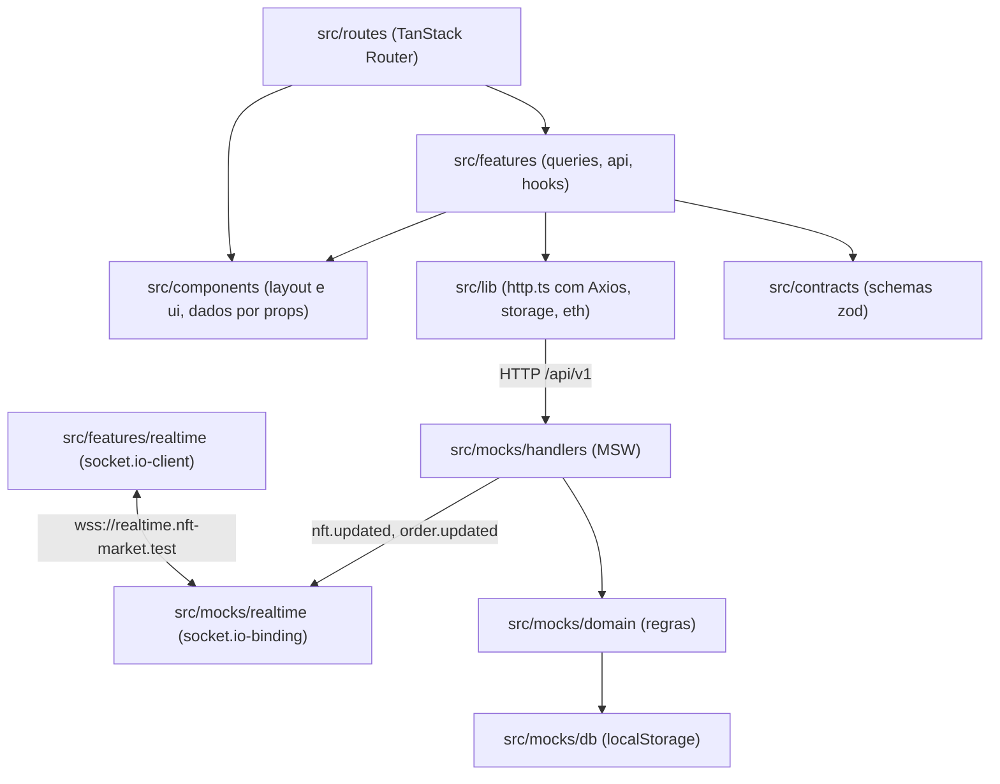

# Arquitetura — Kurio NFT Marketplace

## 1. Camadas e fluxo de dados

A aplicação e o servidor simulado rodam na mesma aba, separados pela rede: o Service Worker do MSW intercepta `fetch` e XHR, e o MSW troca a classe global `WebSocket`. Nenhum componente sabe que a resposta é simulada; trocar o mock por um backend real não mexe na UI.



Hoje `src/features/realtime` tem só o ledger de versões (`event-ledger.ts`); o cliente Socket.IO entra com a camada de tempo real.

Regras de dependência, travadas por `no-restricted-imports` em `eslint.config.js`:

- `axios` só é importado em `src/lib/http.ts`, a instância única, e no teste dela.
- `src/routes/`, `src/components/` e `src/features/*/{components,hooks}/` não importam `@/lib/http`: os dados chegam pelos hooks de `src/features/*/queries.ts`, que usam `src/features/*/api.ts`.
- `src/components/` não importa `features/`, `routes/` nem `app/`. Layout e ui recebem dados por props, e a rota faz a ligação: a raiz passa a sessão, o contador do carrinho e o logout para o header e a tab bar.
- `src/features/` não importa `routes/` nem `app/`. `src/lib/` não importa `app/`, `routes/`, `features/` nem `components/`; de `src/content/` usa só as mensagens de erro do cliente HTTP.
- `src/contracts/` só pode depender de zod e de `src/lib/eth.ts`, porque é compartilhado com o mock e com os testes E2E, que rodam em Node; `src/content/` só reaproveita as mensagens de validação dos contratos.
- O app não importa `src/mocks/`; a única entrada é o `import('./mocks/browser')` dinâmico de `src/main.tsx`. Por sua vez, `src/mocks/` só importa `src/contracts/` e `src/lib/eth.ts`.

### Ordem de boot no cliente

O `engine.io-client` guarda `globalThis.WebSocket` quando o módulo é avaliado. Se o `socket.io-client` carregasse antes do `worker.start()`, o socket escaparia do MSW. Por isso `src/main.tsx` não tem import estático do app: espera `startMocks()` e só então importa `src/app/render.tsx`. O próprio app também carrega o `socket.io-client` com `import()`, dentro do `RealtimeConnection`, depois da primeira pintura: o socket não disputa o LCP e o pacote fica fora do JS inicial.

## 2. Contratos REST

A fonte da verdade é `src/contracts/`: um schema zod por corpo e por resposta, usado pelo cliente e pelos handlers do MSW. Os handlers validam a entrada com `readJson` (`src/mocks/handlers/request.ts`) e passam a saída pelo mesmo schema que o cliente usa antes de responder. Valores em ETH trafegam como string decimal (`EthAmountSchema`), e datas como ISO 8601 em UTC (`z.iso.datetime()`; a data das avaliações é só `AAAA-MM-DD`).

### Cabeçalhos

- `Authorization: Bearer <token>`: sessão autenticada.
- `X-Guest-Cart-Id`: id do carrinho de visitante, gerado no cliente e guardado em `localStorage` (`nftmkt:guest-cart-id`).
- `X-Request-Id`: UUID gerado pelo interceptor do Axios e devolvido pelo servidor simulado em toda resposta.
- `Idempotency-Key`: obrigatório em `POST /orders` (seção 9).

### Endpoints (`/api/v1`)

| Método e rota                    | Auth     | Entrada                                                                                          | Sucesso                                     | Erros principais                                                                                                                          |
| -------------------------------- | -------- | ------------------------------------------------------------------------------------------------ | ------------------------------------------- | ----------------------------------------------------------------------------------------------------------------------------------------- |
| `POST /auth/register`            | Não      | `{ username, email, password }`                                                                  | `201 AuthResponse`                          | `409 EMAIL_TAKEN`, `409 USERNAME_TAKEN`, `422 VALIDATION_FAILED`                                                                          |
| `POST /auth/login`               | Não      | `{ email, password }`                                                                            | `200 AuthResponse`                          | `401 INVALID_CREDENTIALS`, `422 VALIDATION_FAILED`                                                                                        |
| `GET /auth/session`              | Sim      | —                                                                                                | `200 AuthResponse`                          | `401 UNAUTHENTICATED`, `401 SESSION_EXPIRED`                                                                                              |
| `POST /auth/logout`              | Sim      | —                                                                                                | `204` (idempotente)                         | —                                                                                                                                         |
| `GET /nfts`                      | Não      | Query: `q, collection, category, network, tab, minPrice, maxPrice, status, sort, page, pageSize` | `200 NftListResponse`                       | `500 INTERNAL`, `503 UNAVAILABLE`                                                                                                         |
| `GET /nfts/featured`             | Não      | —                                                                                                | `200 FeaturedNftsResponse`                  | `500 INTERNAL`                                                                                                                            |
| `GET /nfts/:id`                  | Não      | —                                                                                                | `200 Nft`                                   | `404 NOT_FOUND`                                                                                                                           |
| `GET /me/favorites`              | Sim      | —                                                                                                | `200 FavoritesResponse`                     | `401`                                                                                                                                     |
| `PUT /me/favorites/:nftId`       | Sim      | —                                                                                                | `204` (idempotente)                         | `401`, `404 NOT_FOUND`                                                                                                                    |
| `DELETE /me/favorites/:nftId`    | Sim      | —                                                                                                | `204` (idempotente)                         | `401`, `404 NOT_FOUND`                                                                                                                    |
| `GET /cart`                      | Opcional | —                                                                                                | `200 Cart` (sem `X-Guest-Cart-Id`, cria um) | `401`                                                                                                                                     |
| `POST /cart/items`               | Opcional | `{ nftId, editionId, quantity }`                                                                 | `200 Cart`                                  | `404 NOT_FOUND`, `409 AVAILABILITY_CONFLICT`                                                                                              |
| `PATCH /cart/items/:itemId`      | Opcional | `{ quantity }`                                                                                   | `200 Cart`                                  | `404 NOT_FOUND`, `409 AVAILABILITY_CONFLICT`                                                                                              |
| `DELETE /cart/items/:itemId`     | Opcional | —                                                                                                | `200 Cart`                                  | `404 NOT_FOUND`                                                                                                                           |
| `PUT /cart/coupon`               | Opcional | `{ code }`                                                                                       | `200 Cart`                                  | `422 COUPON_INVALID`, `422 COUPON_EXPIRED`                                                                                                |
| `DELETE /cart/coupon`            | Opcional | —                                                                                                | `200 Cart`                                  | —                                                                                                                                         |
| `POST /cart/merge`               | Sim      | `{ guestCartId }`                                                                                | `200 MergeCartResponse`                     | `401`                                                                                                                                     |
| `POST /quotes`                   | Opcional | `{ network }`                                                                                    | `200 Quote` (problemas em `issues`)         | `409 CART_EMPTY`                                                                                                                          |
| `POST /wallet-connections`       | Sim      | `{ walletId, network, provider }`                                                                | `200 WalletConnectionResponse`              | `404 NOT_FOUND`, `409 WALLET_REJECTED`, `422 VALIDATION_FAILED` (carteira de outra rede)                                                  |
| `DELETE /wallet-connections/:id` | Sim      | —                                                                                                | `204` (idempotente)                         | `403 FORBIDDEN`                                                                                                                           |
| `POST /orders`                   | Sim      | `{ quoteId, connectionId, buyer }` + `Idempotency-Key`                                           | `201 Order` novo; `200 Order` na repetição  | `400 BAD_REQUEST` (sem chave), `409 QUOTE_OUTDATED`, `409 AVAILABILITY_CONFLICT`, `409 IDEMPOTENCY_KEY_REUSED`, `409 WALLET_DISCONNECTED` |
| `GET /orders/:id`                | Sim      | —                                                                                                | `200 Order`                                 | `403 FORBIDDEN`, `404 NOT_FOUND`                                                                                                          |
| `GET /orders?status=pending`     | Sim      | —                                                                                                | `200 PendingOrdersResponse`                 | `400 BAD_REQUEST` (outro `status`)                                                                                                        |
| `GET /me/profile`                | Sim      | —                                                                                                | `200 Profile`                               | `401`                                                                                                                                     |
| `PATCH /me/profile`              | Sim      | `{ displayName, username, email, ensName, walletNickname }`                                      | `200 Profile`                               | `409 USERNAME_TAKEN`, `409 EMAIL_TAKEN`, `422 VALIDATION_FAILED`                                                                          |
| `PUT /me/avatar`                 | Sim      | `multipart/form-data` com `file` (até 2 MB; PNG, JPEG ou WebP)                                   | `200 AvatarResponse`                        | `413 FILE_TOO_LARGE`, `415 UNSUPPORTED_MEDIA_TYPE`, `422 VALIDATION_FAILED` (sem arquivo)                                                 |
| `DELETE /me/avatar`              | Sim      | —                                                                                                | `200 AvatarResponse` com `avatarUrl: null`  | `401`                                                                                                                                     |
| `POST /me/password`              | Sim      | `{ currentPassword, newPassword }`                                                               | `204`                                       | `422 WRONG_PASSWORD`, `422 VALIDATION_FAILED`                                                                                             |
| `GET /me/wallets`                | Sim      | —                                                                                                | `200 WalletsResponse`                       | `401`                                                                                                                                     |
| `POST /me/wallets`               | Sim      | `CreateWalletInput`                                                                              | `201 Wallet`                                | `409 WALLET_CONFLICT`, `422 VALIDATION_FAILED`                                                                                            |
| `PATCH /me/wallets/:id`          | Sim      | `UpdateWalletInput`                                                                              | `200 Wallet`                                | `403 FORBIDDEN`, `404 NOT_FOUND`, `409 WALLET_CONFLICT`, `422 VALIDATION_FAILED`                                                          |

Valem para todas as rotas: corpo que não é JSON responde `400 BAD_REQUEST`; corpo fora do schema responde `422 VALIDATION_FAILED` com `fieldErrors` pelo caminho do campo (`buyer.email`, por exemplo). Nas rotas com auth opcional, um `Authorization` presente mas inválido ou expirado responde `401` em vez de cair no carrinho de visitante, para o cliente conseguir tratar a expiração. Os `401` sem código na tabela são `UNAUTHENTICATED` ou `SESSION_EXPIRED`.

### Envelope de erro

```json
{
  "error": {
    "code": "VALIDATION_FAILED",
    "message": "Revise os campos destacados.",
    "fieldErrors": { "email": ["E-mail já cadastrado"] },
    "details": {},
    "retryable": false,
    "requestId": "..."
  }
}
```

`retryable` é `true` só para 429, 500 e 503. Uma resposta que falha no próprio schema de saída é bug do servidor simulado e vira `500 INTERNAL`; em desenvolvimento, o erro vai para o console.

No cliente, `src/lib/http.ts` converte todo erro em `ApiError` (`src/lib/api-error.ts`):

- O corpo de erro só é lido se passar no `ApiErrorEnvelopeSchema`; fora dele, a resposta vira `INTERNAL` (5xx) ou `HTTP_ERROR`.
- O timeout de 8 s chega como `ETIMEDOUT` (`transitional.clarifyTimeoutError`). Sem essa opção o Axios usa `ECONNABORTED` também para conexão abortada, que aqui conta como falha de rede.
- `retryable` vem do envelope; sem envelope, é `true` para rede, timeout e HTTP 429, 500 e 503.
- Respostas de sucesso passam por `parseApiResponse`: payload fora do contrato vira `ApiError` com `kind: 'parse'`, tratado pela UI como os demais erros, em vez de um `ZodError` solto.
- `401 SESSION_EXPIRED` avisa os ouvintes de `onSessionExpired` (seção 5).

## 3. Eventos Socket.IO

O servidor simulado em `src/mocks/realtime/server.ts` publica um evento sempre que o domínio altera um NFT ou um pedido. O envelope é o mesmo para os dois tipos (`RealtimeEventSchema` em `src/contracts/realtime.ts`):

```json
{
  "eventId": "uuid",
  "type": "nft.updated",
  "resource": { "kind": "nft", "id": "emerald-ape-042" },
  "version": 5,
  "occurredAt": "2026-10-15T12:00:00.000Z",
  "userId": "só em order.updated",
  "data": {}
}
```

- `nft.updated` vai para todas as conexões. `data` traz as edições (`id`, `price`, `available`) e o `priceFrom` recalculado.
- `order.updated` vai só para as conexões autenticadas como `order.userId`. `data` traz `status` (`pending`, `confirmed` ou `rejected`), `rejectionReason` e `transaction`.
- `version` é a do recurso depois da mudança, a mesma que as respostas REST carregam; é ela que permite descartar evento atrasado (seção 8). `eventId` identifica o envio: o cenário `duplicate-events` repete cada evento com o mesmo `eventId` e depois manda uma cópia com `version` anterior e `eventId` novo.
- No cenário `offline` nenhum evento sai.

No cliente, `src/features/realtime/components/realtime-connection.tsx` (montado uma vez no layout raiz) registra os ouvintes de `nft.updated` e `order.updated` e entrega cada payload a `applyRealtimeEvent` (`src/features/realtime/apply-event.ts`), que passa por cinco portas antes de tocar o cache:

1. Schema: `RealtimeEventSchema.safeParse`; payload inválido é descartado.
2. Dono: evento com `userId` diferente do usuário da sessão é descartado, mesmo que o servidor já filtre.
3. Duplicata e 4. versão: `shouldAcceptEvent` do ledger (seção 8).
4. Aplicação: `nft.updated` corrige preço, estoque, `priceFrom` e `version` no detalhe, nas páginas de listagem, nos destaques e nos favoritos em cache, marca as listagens como velhas sem refazê-las (a ordem ou o filtro da página podem ter mudado) e, se o NFT está num carrinho em cache, invalida carrinho e cotação, que o servidor recalcula. `order.updated` atualiza o pedido em cache, invalida a lista de pendentes e, em estado terminal, o carrinho.

Cada cache também confere a própria versão antes do patch, porque o ledger é zerado no logout enquanto o catálogo público continua em cache. O anúncio na live region polida sai só para o que a pessoa está vendo ou vai comprar: as edições de um carrinho em cache e as do detalhe aberto. Os textos são "O preço de Emerald Ape #042 (1/50) mudou para 1.35 ETH" e "Emerald Ape #042 (1/50) esgotou"; o `announce` junta mensagens próximas num anúncio só, e `markSideEffectOnce` impede repetir o anúncio da mesma versão.

## 4. Servidor simulado: transporte, cenários e limitações

- REST: o Service Worker (`public/mockServiceWorker.js`) intercepta `fetch` e XHR; os handlers ficam em `src/mocks/handlers/`.
- WebSocket: o MSW troca a classe global `WebSocket` na mesma aba e o `@mswjs/socket.io-binding` (`toSocketIo(connection)`) fala o protocolo do Socket.IO. O long-polling do Engine.IO não é interceptado, então o cliente precisa usar só o transporte `websocket`.
- Ping manual: o binding 0.2.0 anuncia `pingInterval: 25000` e `pingTimeout: 5000`, mas nunca envia ping. O mock envia `connection.client.send('2')` a cada 20 s e limpa o intervalo no `close`; sem isso o cliente derruba a conexão por "ping timeout" aos 30 s.
- Usuário do socket: o binding confirma o CONNECT antes de expor o `auth`, então o mock lê o pacote cru `40{"token":"…"}` e associa a conexão ao `userId`. Sem token válido a conexão fica anônima e só recebe `nft.updated`.
- Sem rooms nem acks: o binding não tem essas APIs. O mock guarda as conexões num `Map`, filtra por `userId` a cada emissão e não espera confirmação de entrega.
- Conexão recusada (cenário `offline` ou janela de `__mock.dropSockets({ refuseForMs })`): o mock dispara `error` no WebSocket e depois fecha com 1013, como um navegador faz num handshake recusado. Só com o `close`, o Manager do Socket.IO, que antes do handshake escuta apenas `error`, ficava esperando para sempre e nunca tentava de novo.
- `window.__mock.listSockets()` devolve o `userId` de cada conexão aberta (`null` para visitante). O E2E espera o socket do usuário certo antes de mudar algo no servidor, porque evento emitido antes da conexão se perde.

### Banco e domínio

O banco é um único `MockDb` em `localStorage` (`nftmkt.mockdb.v1`), gravado a cada mutação e recarregado pelo evento `storage` quando outra aba o altera. O campo `schemaVersion` (hoje 2) diferente do esperado descarta o banco e re-semeia.

As regras ficam em `src/mocks/domain/` como funções sobre o `MockDb`, sem leitura de cenário nem de `localStorage`, testadas com Vitest. `inventory.ts` concentra preço e estoque: toda mudança recalcula `priceFrom`, incrementa a `version` do NFT e a `version` de cada carrinho que o contém, para nenhuma cotação ser reaproveitada com linhas velhas.

### Cenários

- `src/mocks/scenarios/registry.ts` é a única fonte do cenário ativo (`localStorage`, chave `nftmkt:scenario`). Id desconhecido em `?scenario=` é ignorado; em `window.__mock.setScenario` lança erro.
- `src/mocks/scenarios/network.ts` aplica, nesta ordem, as regras de `__mock.setRules`/`__mock.hold`, as falhas do cenário (`offline`, `server-error`, `flaky`) e a latência (40–120 ms, 1,5–3 s no `slow`, inversa a `q` no `race`), sorteada por um PRNG mulberry32 com semente fixa.
- `src/mocks/scenarios/checkout.ts` guarda os ganchos de pedido. `price-change-checkout`, `sold-out-checkout` e `wallet-disconnect` mexem no banco uma vez por usuário (marca em `scenarioMarks`) antes de o domínio validar o `POST /orders`; o cliente recebe a falha pelas mesmas checagens que uma mudança real dispararia.
- A confirmação ou recusa do pedido é agendada em `settlements`, dentro do banco, 1,5 s após a criação (`src/mocks/realtime/settlements.ts`). O boot reagenda o que estiver pendente, então um refresh com pedido `pending` não deixa o pedido parado.
- `window.__mock.countOrders(userId)` não conta o pedido que vem no seed, para o teste afirmar "exatamente um pedido novo".

## 5. Rotas, proteção e política de sessão

### Árvore de rotas e proteção (`src/routes/*`)

| Rota                                 | Arquivo                                                     | Acesso         | Comportamento no `beforeLoad` / `loader`                                                                                                                                                                                                                                                                                         |
| ------------------------------------ | ----------------------------------------------------------- | -------------- | -------------------------------------------------------------------------------------------------------------------------------------------------------------------------------------------------------------------------------------------------------------------------------------------------------------------------------- |
| `__root`                             | `src/routes/__root.tsx`                                     | Público        | Resolve a sessão com `ensureQueryData` (erro vira `null`) e a coloca no contexto; renderiza `SiteHeader` (desktop), `SiteFooter`, `MobileTabBar` (mobile), `Announcer`, `Toaster` e `ScenarioPanel`                                                                                                                              |
| `/`                                  | `src/routes/index.tsx`                                      | Público        | Valida search params com `CatalogSearchSchema` (`.catch()` em cada campo) e remove valores padrão da URL via `stripSearchParams`; o loader dispara `prefetchQuery` da listagem sem `await`                                                                                                                                       |
| `/nft/$nftId`                        | `src/routes/nft.$nftId.tsx`                                 | Público        | Valida `?edition=`; 404 da API dispara `notFound()` com tela dedicada ("NFT não encontrado")                                                                                                                                                                                                                                     |
| `/cart`                              | `src/routes/cart.tsx`                                       | Público        | O carrinho é o do visitante (`X-Guest-Cart-Id`) ou o do usuário logado                                                                                                                                                                                                                                                           |
| `/login`, `/register`                | `src/routes/login.tsx`, `src/routes/register.tsx`           | Visitante      | Com sessão, redireciona para `redirect` ou `/`. `redirect` passa por `toSafeRedirect` (`src/lib/redirect.ts`): só vale caminho da mesma origem, resolvido contra uma origem fixa, o que também barra `//host` e `/\host`. No desktop, `AuthScreen` renderiza o Início atrás e o formulário num Dialog; no mobile, uma tela cheia |
| `/_authenticated`                    | `src/routes/_authenticated.tsx`                             | Privado        | Sem `context.session`, lança `redirect({ to: '/login', search: { redirect: location.href } })`                                                                                                                                                                                                                                   |
| `/checkout`                          | `src/routes/_authenticated/checkout.tsx`                    | Privado        | Protegida pelo layout `_authenticated`                                                                                                                                                                                                                                                                                           |
| `/orders/$orderId`                   | `src/routes/_authenticated/orders.$orderId.tsx`             | Privado (dono) | Protegida por sessão e validada no servidor pelo `userId` do pedido (`403 FORBIDDEN` para outro usuário)                                                                                                                                                                                                                         |
| `/profile`, `/wallets`, `/favorites` | `src/routes/_authenticated/{profile,wallets,favorites}.tsx` | Privado        | Compartilham o `AccountLayout`: barra lateral de 310 px no desktop, fileira de pílulas no mobile                                                                                                                                                                                                                                 |

### Política de sessão e expiração com retomada

A sessão é um token opaco (`kurio-tok-…`) com expiração, guardado em `localStorage` (`nftmkt:session`). O `beforeLoad` da raiz resolve a sessão uma vez com `ensureQueryData` e a entrega no contexto; `_authenticated`, `/login` e `/register` leem `context.session` em vez de consultar de novo.

- Boot: com token salvo, `GET /auth/session`. `401` apaga o token e o usuário segue como visitante. Erro de rede ou `5xx` (cenários `offline` e `flaky`) mantém o token: a navegação continua como visitante e a próxima verificação recupera a sessão.
- Revalidação: a consulta da sessão tem `staleTime: Infinity` e `refetchOnWindowFocus: 'always'`; é o foco da janela que percebe uma sessão vencida em segundo plano.
- Expiração durante o uso: qualquer `401 SESSION_EXPIRED` faz o interceptor do Axios chamar os ouvintes de `onSessionExpired` (`src/lib/http.ts`), sem importar o router. O hook `useSessionSync` (`src/features/auth/hooks/use-session-sync.ts`), montado na raiz, grava `{ href, reason: 'expired', userId }` em `sessionStorage` (`nftmkt:resume`), limpa o cache privado e navega para `/login?redirect=<href>&reason=expired`. Ele só age se havia sessão no cache: um token já vencido no boot é resolvido pela própria consulta, e vários `401` seguidos disparam o fluxo uma vez.
- Retomada: o login mostra "Sua sessão expirou. Entre novamente para continuar." em `role="status"`. Depois do login, `useCompleteAuth` consome o `nftmkt:resume`: se quem entrou é o mesmo `userId`, volta ao `href` com a URL inteira (a edição escolhida no detalhe, por exemplo); se é outra pessoa, vai para `/`, para ninguém cair na página privada de outro usuário. Um reload com o token já vencido não é retomada: o boot trata como visitante.
- Login e cadastro (`src/features/auth/components`): React Hook Form com os schemas de `src/contracts` (`LoginInputSchema`; `RegisterInputSchema` mais a confirmação de senha). Erro de campo fica abaixo do input, ligado por `aria-describedby` com `aria-invalid`, e o foco vai para o primeiro inválido. `401 INVALID_CREDENTIALS` vira um resumo no topo do formulário ("E-mail ou senha incorretos") que recebe o foco. No cadastro, os `fieldErrors` do `409` (`EMAIL_TAKEN`, `USERNAME_TAKEN`) vão para o campo deles. Os campos de senha são limpos depois de cada envio, com sucesso ou não.
- Depois de um login ou cadastro com sucesso (`useCompleteAuth`): grava a sessão, faz o merge do carrinho de visitante, avisa por toast cada ajuste de quantidade do merge e navega para `redirect` (ou `/`) com `replace`, para o voltar do navegador não reabrir o formulário.
- Troca de usuário: `applyAuthenticatedSession` limpa o cache privado antes de gravar a sessão nova quando o `userId` muda, e todas as chaves privadas levam o `userId`. O teste `03-auth-session` observa o DOM a partir do logout e falha se algum card da lista de interesse aparecer na tela do usuário seguinte, mesmo por um frame.
- Limpeza do cache privado (`clearPrivateCache`): a sessão vira `null` antes de `removeQueries` em `['user']`, `['cart']` e `['quote']`, para nenhuma consulta montada refazer o pedido com a chave do usuário anterior; o ledger de eventos também é zerado.
- Logout (`useSignOut`): `POST /auth/logout` (erro de rede ignorado), apaga o token e o id de visitante, cria um id de visitante novo, limpa o cache privado e, se a rota atual é privada, volta para `/`.
- Outras abas: o evento `storage` em `nftmkt:session` sincroniza login e logout. Se o usuário mudou (logout ou troca de conta), a aba limpa o cache privado e invalida o router, o que tira uma rota privada da tela.
- Trade-off: com backend real, o token iria num cookie `httpOnly; Secure; SameSite=Lax` com refresh rotativo. O MSW no navegador não emula `httpOnly`, então optei pelo `localStorage` e mantive todas as chaves privadas com o `userId`.

## 6. Carrinho, cotação e valores em ETH

- Valores em ETH trafegam como string decimal (`EthAmount`) e todo cálculo em `src/lib/eth.ts` usa `bigint` em wei (18 casas). O mesmo módulo serve o app e o mock, e o Vitest faz a ida e volta (`formatEth(parseEth(x))`) de todos os valores do seed.
- Visitante: o cliente gera o id do carrinho e o envia em `X-Guest-Cart-Id`. Sem o cabeçalho, o servidor cria um carrinho com id próprio em vez de reaproveitar um carrinho anônimo comum.
- Mesclagem no login: `POST /cart/merge` soma as quantidades do visitante às do usuário, limita cada linha a `min(available, maxPerOrder)`, descreve cada corte em `adjustments` e mantém o cupom do visitante quando o usuário não tem um. O carrinho de visitante é apagado.
- Cotação como verdade: subtotal, desconto, taxa (0.016 ETH na Ethereum, 0.002 na Polygon e 0.001 na Solana) e total saem de `POST /quotes`. Estoque insuficiente, edição esgotada e cupom inválido ou expirado aparecem em `issues` e bloqueiam a compra. `PRICE_CHANGED` compara o preço atual com `unitPriceWhenAdded` e só informa: a cotação já traz o preço novo.
- Pós-compra: na confirmação, o servidor subtrai do carrinho exatamente as linhas e quantidades do recibo; o que foi adicionado depois da cotação continua lá. A recusa devolve o estoque reservado e não mexe no carrinho.

### Tela do carrinho (`/cart`, `src/features/cart`)

- Cada linha do `Cart` traz o que a tela mostra (`title`, `tokenId`, `editionName`, `image`) e o que o stepper precisa (`unitPrice`, `available`, `maxPerOrder`), no mesmo formato da linha do recibo. A tela inteira sai de uma requisição, sem um `GET /nfts/:id` por linha, e o servidor atualiza preço e estoque de toda linha a cada mudança da edição (`commitNftChange`).
- A cotação do carrinho é pedida na Ethereum (`CART_QUOTE_NETWORK`), por isso a taxa aparece como "Taxa estimada"; o pagamento cota de novo na rede escolhida. Subtotal, desconto, taxa, total e o total de cada linha vêm da cotação. Enquanto a cotação da versão nova do carrinho não chega, o total da linha mostra preço × quantidade (`lineTotal`, só exibição) e o resumo fica atenuado com `aria-busy`.
- Avisos da linha vêm de `quote.issues`: `PRICE_CHANGED` mostra "Preço mudou de 1.19 para 1.35 ETH" e não bloqueia; `INSUFFICIENT_STOCK` mostra "Restam 2 unidades" com o botão "Ajustar para 2", que faz o `PATCH` da quantidade; `EDITION_SOLD_OUT` mostra "Esta edição esgotou." e trava o stepper. Um cupom que deixou de valer depois de aplicado aparece abaixo do chip.
- "Conectar e finalizar" fica `aria-disabled` enquanto a cotação da versão atual não chega, quando ela falha e quando há `issues` que bloqueiam. Os motivos aparecem embaixo do botão, ligados por `aria-describedby` (`checkoutBlockers`). Sem bloqueio, o botão vai a `/checkout`; o visitante cai no guard, que o manda para `/login?redirect=%2Fcheckout`, e o login mescla o carrinho antes de seguir.
- Quantidade: o stepper vai de 1 a `min(available, maxPerOrder)` e cada clique é um `PATCH /cart/items/:id`. Enquanto a resposta não chega, o stepper mostra o número pedido e fica desabilitado; o cache continua com o carrinho do servidor, então uma falha volta ao valor anterior sem rollback manual. Um `409 AVAILABILITY_CONFLICT` (estoque que caiu sem a tela saber) vira toast com a mensagem do servidor e refaz o `GET /cart`.
- Cupom: `PUT /cart/coupon` grava o código no carrinho. `422 COUPON_INVALID` e `COUPON_EXPIRED` chegam em `fieldErrors.code` e aparecem no campo com `aria-invalid` e `aria-describedby`. Aplicado, o campo vira o chip "BEMVINDO10 · Remover"; o foco vai para "Remover" e, ao remover, volta ao campo.

## 7. Estratégia de cache, retries e sincronização

As chaves do TanStack Query ficam em `src/lib/query-keys.ts` (`qk`), e toda chave de dado privado carrega o dono: `['user', userId, ...]` para favoritos, perfil, carteiras e pedidos, `['cart', 'user:<id>']` ou `['cart', 'guest:<id>']` para o carrinho e `['quote', dono, rede, versão do carrinho]` para a cotação. No logout ou na troca de usuário, `clearPrivateCache` remove `['user']`, `['cart']` e `['quote']` inteiros (seção 5).

Padrões do `QueryClient` (`src/app/query-client.ts`):

- `staleTime` de 30 s.
- Até 2 novas tentativas, só quando `ApiError.retryable` é `true` (rede, timeout, HTTP 429, 500 e 503), com espera de `min(500 × 2^tentativa, 4000)` ms.
- Mutations sem retry automático.

| Consulta                | Chave                           | `staleTime`   | Revalidação                                                                                                                                                                          |
| ----------------------- | ------------------------------- | ------------- | ------------------------------------------------------------------------------------------------------------------------------------------------------------------------------------ |
| `sessionQueryOptions`   | `['session']`                   | `Infinity`    | `refetchOnWindowFocus: 'always'`, sem retry; `401` vira `null`                                                                                                                       |
| `cartQueryOptions`      | `['cart', dono]`                | `0`           | No foco da janela; o contador do header lê a mesma consulta (`select`). Toda mutation do carrinho grava a resposta nesta chave e, se falhar, a invalida                              |
| `quoteQueryOptions`     | `['quote', dono, rede, versão]` | `0`           | Uma nova tentativa, só em falha retryable. Só roda com itens; a versão nova do carrinho é outra chave, e a cotação anterior fica na tela (`placeholderData`) só se for do mesmo dono |
| `nftQueryOptions`       | `['nfts', 'detail', id]`        | padrão (30 s) | O loader de `/nft/$nftId` chama `ensureQueryData`; `404` vira `notFound()`                                                                                                           |
| `nftListQueryOptions`   | `['nfts', 'list', busca]`       | 30 s          | `placeholderData: keepPreviousData`: a página anterior fica na tela enquanto a próxima carrega. O `signal` vai para o Axios, então a requisição de uma busca superada é abortada     |
| `featuredQueryOptions`  | `['nfts', 'featured']`          | 60 s          | Hero e banner da barra lateral                                                                                                                                                       |
| `favoritesQueryOptions` | `['user', userId, 'favorites']` | 30 s          | Só roda com sessão (`enabled`); a mutation de favorito escreve nela de forma otimista e a invalida no fim                                                                            |

### Catálogo: a URL é o estado

- Filtros, aba, ordenação e página moram nos search params de `/` (`CatalogSearchSchema`): `q`, `collection`, `category`, `network`, `tab`, `minPrice`, `maxPrice`, `status`, `sort`, `page` e `pageSize`. Todo campo tem `.catch()`, então uma URL editada à mão volta ao padrão em vez de derrubar a rota, e o `stripSearchParams` tira da URL o que é padrão (`tab=all`, `sort=recent`, `page=1`, `pageSize=9`).
- A requisição leva os mesmos parâmetros da URL mais os padrões, e o teste E2E confere a igualdade.
- Mudar um filtro, a aba ou a ordenação volta para a página 1 (`applyCatalogChange`); só os links de paginação mexem em `page`.
- Categoria, rede, aba e página são links de verdade, com `href`, e a opção ativa leva `aria-current` (`"true"` nos filtros, `"page"` na página atual). Clicar na categoria ativa a desfaz. Todos apontam para `#mercado`, então o router rola até o topo do catálogo.
- Aplicar um filtro cria uma entrada no histórico, então voltar e avançar restauram a vista anterior, na URL e na tela.
- O preço usa o slider do Radix em passos de 0,01 ETH, com `bigint`. Os limites vêm de `facets.priceRange`, calculados sobre o catálogo inteiro, e um slider parado nos limites não escreve nada na URL. O botão "Aplicar" grava `minPrice` e `maxPrice`.
- As contagens de categoria e de rede vêm de `facets` e já descontam o próprio filtro: o número ao lado de "Música" é quantos NFTs a lista teria se a pessoa escolhesse "Música" com os outros filtros que já escolheu.
- O campo de busca do mobile grava na URL 300 ms depois da última tecla, ou no Enter, e usa `replace`, para a digitação não empilhar uma entrada de histórico por pausa. O campo da busca do header, no desktop, grava no Enter e abre com o `q` da URL. O texto que a pessoa digita enquanto o eco da própria gravação volta nunca é sobrescrito: o campo só adota o valor da URL quando ele muda por outro motivo (voltar, avançar, "Limpar filtros").
- Busca e coleção não aparecem na barra lateral, então a grade mostra um chip por filtro ativo (`Busca: emerald`, `Coleção: Kurio Apes`) que é um link para removê-lo.

### Cache da listagem

- A chave é a própria busca já validada (`['nfts', 'list', busca]`), então duas URLs que significam a mesma coisa compartilham o cache. O `staleTime` é de 30 s.
- `placeholderData: keepPreviousData`: ao mudar a vista, a grade anterior continua na tela, atenuada e com `aria-busy="true"`, até a nova chegar. A grade nunca fica em branco entre duas buscas.
- O `signal` vai para o Axios. Quando a chave perde o último observador, o Query aborta a requisição, e a resposta de uma busca superada não chega à tela. Se chegasse, só preencheria o cache da chave dela, nunca a vista atual.
- O loader da rota faz `prefetchQuery` da listagem sem `await`: a página renderiza os skeletons na hora e o cache já está aquecido quando a resposta chega.
- Quatro estados: carregando (skeleton com as dimensões dos cards e da paginação, `aria-busy` e o texto oculto "Carregando catálogo…"), atualizando (os dados anteriores), vazio (com "Limpar filtros" quando há filtro ativo) e erro (a mensagem da `ApiError` e "Tentar novamente"). Falhas retryable são tentadas de novo duas vezes antes de o erro aparecer.
- Depois de cada mudança de vista, o `Announcer` diz quantos resultados ela tem ("7 resultados"). A primeira carga fica em silêncio.
- Uma `page` acima do total, digitada na URL ou deixada para trás por um filtro que encolheu a lista, é trocada pela última página com `replace`, sem entrada nova no histórico.

### Detalhe do NFT

- `/nft/$nftId` espera `ensureQueryData` no loader. Enquanto a resposta não chega (depois de 200 ms, por no mínimo 400 ms), o `pendingComponent` mostra o skeleton da galeria e da coluna de detalhes com `aria-busy` e o texto oculto "Carregando NFT…". `404` vira o `notFoundComponent` ("NFT não encontrado"); outra falha cai no `RouteErrorBoundary`, cujo "Tentar novamente" invalida o router e repete o loader.
- A edição escolhida mora em `?edition=<id>`, gravada com `replace` para a troca de pílula não empilhar histórico. `resolveEdition` (`src/features/nft/editions.ts`) deriva a escolha a cada render, sem efeito: uma edição esgotada ou inexistente na URL mostra "Esta edição está indisponível" e seleciona a primeira com estoque; sem nenhuma com estoque, a compra fica desabilitada.
- O limite da quantidade é `min(available, maxPerOrder) − quantidade da mesma edição já no carrinho` (`quantityLimit`), lido da consulta do carrinho. O stepper trava no limite e a mensagem diz por quê; com o limite em 0, a compra fica desabilitada. O servidor simulado repete a checagem, e a mensagem do `ApiError` vira toast se ela falhar.
- "COMPRAR" (e "Comprar NFT" no mobile) chama `POST /cart/items` e só navega para `/cart` depois da resposta, que é gravada direto em `['cart', dono]`; o contador do header lê a mesma consulta. O botão do carrinho da barra mobile só adiciona e mostra o toast "Adicionado ao carrinho" com a ação "Ver carrinho". Numa falha, a consulta do carrinho é invalidada.
- "Mais desta coleção" usa `nftListQueryOptions` com `collection` e `pageSize: 15`, a mesma chave do catálogo filtrado por coleção, e tira o NFT atual da lista.

### Favoritos: atualização otimista com rollback

`useFavorite(nft)` (`src/features/favorites/queries.ts`) segue o padrão abaixo:

1. `onMutate`: `cancelQueries` na chave de favoritos, para um refetch em voo não sobrescrever o estado otimista; guarda o valor anterior e grava o novo com `toggleFavorite`.
2. `onError`: devolve o valor anterior e mostra o toast "Não foi possível atualizar seus favoritos.".
3. `onSettled`: invalida a chave, e o servidor tem a última palavra.

A mutation tem `scope: { id: 'favorite:<nftId>' }`. O `onMutate` de cada clique roda na hora, então o coração muda no mesmo quadro, mas as requisições do mesmo NFT vão em série e na ordem dos cliques: dois cliques rápidos nunca terminam com o servidor num estado e a tela em outro. NFTs diferentes não esperam um pelo outro. Sem sessão, o clique leva a `/login?redirect=<rota atual>`, e o login devolve a pessoa ao detalhe.

## 8. Reconciliação REST e Socket.IO

`src/features/realtime/event-ledger.ts` guarda os últimos 500 `eventId` e a maior `version` conhecida de cada NFT e pedido, venha ela de uma resposta REST ou de um evento. O detalhe do NFT registra a `version` recebida, e as respostas de carrinho e cotação registram a `nftVersion` de cada linha (`recordResourceVersion`).

- `shouldAcceptEvent` descarta um `eventId` repetido e um evento cuja `version` não passa da conhecida. Um id que saiu da janela de 500 continua barrado pela versão.
- `markSideEffectOnce` libera toast, navegação ou anúncio uma vez por recurso e versão, e nunca para uma versão mais antiga do que uma que já rodou.
- Logout, troca de usuário e sessão expirada zeram o ledger junto com o cache privado (`clearPrivateCache`). O login de um visitante não zera: até ali o ledger só tem versões de NFTs, que são públicas.

### Ciclo da conexão

- Um único socket por aba (`src/features/realtime/socket.ts`), só transporte `websocket`, `autoConnect: false` e backoff determinístico (500 ms a 4 s, sem aleatoriedade). A função `auth` relê o token a cada (re)conexão.
- O efeito do `RealtimeConnection` depende do `userId` da sessão: login, logout ou troca desconectam e conectam de novo, e o servidor passa a associar a conexão ao usuário novo (ou a nenhum). Os ouvintes saem com `socket.off` na limpeza, então navegar não duplica anúncio.
- Queda: `disconnect` (exceto o pedido pelo próprio app) ou `connect_error` marcam o estado `disconnected` em `connection-status.ts`. Depois de 2 s desconectado, aparece o aviso "Reconectando…" numa sobreposição fixa no topo, com `role="status"`, sem empurrar o layout.
- Reconexão: no `connect` que sucede uma queda, invalido as consultas de NFTs, carrinho, cotação e pedidos do usuário. Só as ativas refazem a requisição; as outras ficam marcadas como velhas. É o REST que recupera o que mudou enquanto nenhum evento chegava. Se a resposta trouxer a mesma `version` que um evento atrasado, o ledger já barra o evento.
- `useRealtimeStatus` expõe o estado da conexão (`idle`, `connected`, `disconnected`) para quem precisa de polling de reserva enquanto o socket está fora.

### Pedido: REST e `order.updated` em qualquer ordem

- `POST /orders` e `GET /orders/:id` registram a `version` do pedido no ledger. A resposta do `POST` só entra no cache se a versão dela não for menor que a conhecida: no cenário `order-timeout`, o `order.updated` de confirmação chega antes da resposta, e semear o cache com o `pending` dela deixaria a tela parada num estado que o ledger já não deixa nenhum evento corrigir. Nesse caso a página do pedido busca o estado atual.
- `applyOrderUpdated` só atualiza um pedido que já está no cache e, em estado terminal, apaga a tentativa de checkout guardada e invalida o carrinho (o servidor já tirou as linhas compradas).
- Uma confirmação que chega com o comprador ainda em `/checkout` (resposta lenta ou reenviada) leva à página do pedido, uma vez por versão (`markSideEffectOnce`).
- Com o pedido `pending` e o socket fora (`useRealtimeStatus` diferente de `connected`), a consulta do pedido faz polling a cada 2 s. Na reconexão, a reconciliação invalida os pedidos do usuário. Os dois caminhos chegam ao mesmo estado, porque ambos leem o REST.
- A página do pedido renderiza o recibo só quando o status vindo da API (ou do evento) é `confirmed`, e só a partir de `receipt`, nunca do catálogo.

### Cotação revisada no pagamento

O `/checkout` mostra e confirma a cotação que o comprador revisou, guardada em estado local por `useReviewedQuote` (`src/features/checkout/queries.ts`); a consulta de cotação continua sendo a de `qk.quote(dono, rede, versão do carrinho)`.

- Uma cotação nova substitui a revisada sozinha quando a mudança veio do próprio comprador (cupom, rede) ou quando os valores são iguais (mesmas linhas, preços e total, outro `id`).
- Quando um `nft.updated` leva o ledger a uma versão acima da `nftVersion` de alguma linha revisada (`isQuoteBehind`), a revisada fica obsoleta: "Confirmar compra" fica `aria-disabled`, aparece "Atualizando a cotação…" e, quando a cotação nova chega, uma tabela com o total de cada linha alterada e o total geral antes e agora. Só o clique em "Revisar nova cotação" troca a cotação que será confirmada.
- O ledger não é reativo: a checagem roda no render, e o render acontece porque o mesmo evento invalida `['cart']` e `['quote']`.

## 9. Idempotência e revalidação de pedidos

`POST /orders` exige `Idempotency-Key`. O servidor guarda `userId + chave → { hash SHA-256 do corpo, orderId }` por 24 h:

- mesma chave e mesmo corpo: devolve o pedido existente com `200`, sem reservar estoque de novo;
- mesma chave e corpo diferente: `409 IDEMPOTENCY_KEY_REUSED`.

A repetição é conferida antes de qualquer outra regra, por isso o reenvio depois de um timeout recupera o pedido mesmo que a conexão da carteira já tenha caído. Para um pedido novo, o servidor revalida só as linhas cotadas: conexão ativa e do mesmo usuário (`409 WALLET_DISCONNECTED`), validade de 10 min, rede da conexão igual à da cotação, cupom igual ao do carrinho e ainda válido, taxa da rede, presença no carrinho com a quantidade cotada, estoque (`409 AVAILABILITY_CONFLICT`) e preço e `version` de cada NFT. Qualquer divergência que não seja de estoque responde `409 QUOTE_OUTDATED` com a cotação nova em `details.quote`. Item extra no carrinho não invalida a cotação.

O estoque é reservado na criação e devolvido na recusa; o recibo é uma cópia gravada uma vez, que o catálogo não altera depois.

### No cliente (`src/features/orders`)

- `checkoutAttemptFor` grava `{ key, quoteId, bodyHash }` em `localStorage`, na chave `checkout-attempt:<userId>`, antes do primeiro envio. `bodyHash` é o SHA-256 de `{ quoteId, connectionId, buyer }`: o mesmo corpo reaproveita a chave, e só um corpo diferente (cotação nova, outra conexão, outro comprador) ganha uma chave nova.
- `placeOrder` envia e, se a resposta se perder (`timeout` ou `network`), reenvia o mesmo corpo com a mesma chave até 3 vezes, mostrando "Verificando seu pedido…". Depois do último reenvio, procura em `GET /orders?status=pending` o pedido com o `quoteId` da tentativa. Uma resposta do servidor (409, 422) nunca é reenviada.
- O botão ignora o segundo clique enquanto o primeiro está em voo (uma `ref`, não só o estado visual) e mostra "Processando…".
- Respostas tratadas: `QUOTE_OUTDATED` marca a cotação revisada como recusada e oferece a cotação de `details.quote` (ou a próxima que chegar) para revisão; a confirmação seguinte leva corpo novo e, portanto, chave nova. `AVAILABILITY_CONFLICT` refaz carrinho e cotação, e o botão aponta de volta para o carrinho. `WALLET_DISCONNECTED` deixa a opção em "Desconectada · Reconectar".
- Ao abrir `/checkout`, se existe tentativa guardada, a tela consulta os pedidos pendentes; achando o da tentativa, vai para ele. Assim, um refresh ou uma reconexão no meio da compra cai no mesmo pedido em vez de comprar de novo.
- O estado terminal (por evento ou pela leitura REST na página do pedido) apaga a tentativa. "Tentar de novo" depois de uma recusa abre o checkout, que pede cotação nova.

### Antes do envio, no cliente

- A conexão da carteira é estado do servidor: escolher um provedor em "Carteira e rede" (ou em "Tipo de carteira", que é o mesmo estado) chama `POST /wallet-connections` com a carteira e a rede escolhidas. A opção mostra "Conectando…", "Conectada" ou "Recusada · Tentar de novo" e cada mudança é anunciada na live region. Trocar de carteira, de rede ou de provedor descarta a conexão anterior (`DELETE /wallet-connections/:id`, sem esperar a resposta).
- A rede da cotação é sempre a da carteira escolhida. No desktop, o select "Rede" lista as três redes e desabilita, com "(sem carteira)", as que não têm carteira salva; trocar a rede escolhe a carteira principal dela e pede cotação nova.
- "Confirmar compra" mostra um motivo de bloqueio por vez, na ordem em que o comprador pode agir: cotação obsoleta, problema do carrinho (com link de volta) e carteira não conectada.

## 10. Registro de decisões

| Decisão                                                                                                                                                       | Alternativas avaliadas                                                               | Motivo da escolha                                                                                                                                                                                                                                                                               |
| ------------------------------------------------------------------------------------------------------------------------------------------------------------- | ------------------------------------------------------------------------------------ | ----------------------------------------------------------------------------------------------------------------------------------------------------------------------------------------------------------------------------------------------------------------------------------------------- |
| Vite 8 + npm com `package-lock.json`                                                                                                                          | pnpm / Bun                                                                           | Compatibilidade direta na Vercel e no ambiente de avaliação sem necessidade de habilitar Corepack                                                                                                                                                                                               |
| TypeScript fixado em `~6.0.3`                                                                                                                                 | `typescript@latest` (7.0)                                                            | O `typescript-eslint` 8.x exige `<6.1.0`; configuração usa `paths` sem `baseUrl`                                                                                                                                                                                                                |
| MSW fixado em `^2.15.0`                                                                                                                                       | `msw@latest` (3.0)                                                                   | O `@mswjs/socket.io-binding` 0.2.0 depende da API de eventos de conexão do MSW 2.x                                                                                                                                                                                                              |
| ESLint fixado em `^9.39.0`                                                                                                                                    | `eslint@latest` (10.x)                                                               | Compatibilidade de peer dependency com `eslint-plugin-jsx-a11y` 6.10.2                                                                                                                                                                                                                          |
| Validação de search params com Zod 4 direto                                                                                                                   | `@tanstack/zod-adapter`                                                              | O TanStack Router suporta Standard Schema nativamente com Zod 4, dispensando adaptador externo                                                                                                                                                                                                  |
| Fonte `Roboto Mono Variable` auto-hospedada em `/fonts/`                                                                                                      | Google Fonts CDN ou import CSS do Fontsource                                         | Evita conexão externa no LCP e mantém caminho fixo sem hash para `<link rel="preload">` no `index.html`, acompanhado de `@font-face` de fallback com métricas ajustadas (`ascent-override: 104.79%`, `descent-override: 27.1%`)                                                                 |
| `src/routeTree.gen.ts` versionado no Git                                                                                                                      | Gerar apenas em build/dev                                                            | Permite que `npm run typecheck` (`tsc -b`) passe imediatamente após `npm ci` num checkout limpo                                                                                                                                                                                                 |
| `.env` versionado com padrões públicos da simulação                                                                                                           | `.env.example` com cópia manual                                                      | Não há segredos no projeto; versionar `.env` (ignorando `.env.local` no `.gitignore`) garante que `npm ci && npm run ci` e o deploy na Vercel funcionem sem etapa manual                                                                                                                        |
| Hashes PBKDF2 do seed pré-calculados                                                                                                                          | Calcular PBKDF2 no boot inicial                                                      | Mantém a verificação criptográfica real via Web Crypto (`100.000` iterações SHA-256) sem penalizar o TBT/LCP na primeira abertura da página                                                                                                                                                     |
| Código `CART_EMPTY` para cotar carrinho vazio                                                                                                                 | `400 BAD_REQUEST`                                                                    | O contrato pede `409` para carrinho vazio; um código próprio evita usar `BAD_REQUEST`, que pertence ao `400`                                                                                                                                                                                    |
| `PRICE_CHANGED` só informa                                                                                                                                    | Bloquear a compra até um "aceite"                                                    | A cotação já carrega o preço novo e o contrato não tem rota de aceite; bloquear deixaria o item preso no carrinho                                                                                                                                                                               |
| Ganchos de cenário fora do domínio                                                                                                                            | `if (cenário)` dentro das regras                                                     | O domínio fica puro e testável; o cenário altera o banco antes da validação, e a falha chega pelas mesmas checagens de uma mudança real                                                                                                                                                         |
| Liquidação do pedido gravada no banco                                                                                                                         | `setTimeout` em memória                                                              | Um refresh com pedido pendente perdia o timer e o pedido nunca saía de `pending`                                                                                                                                                                                                                |
| `DELETE /me/avatar` para remover o avatar                                                                                                                     | `PUT /me/avatar` com JSON                                                            | Uma rota com dois formatos de corpo exigia validação em dobro; a remoção ganha rota própria                                                                                                                                                                                                     |
| Números sem aspas na URL                                                                                                                                      | Serializador padrão do TanStack Router                                               | O padrão grava `minPrice=%220.5%22`. Com `parseQuotableJson` (`src/app/router.ts`), número vai sem aspas e os schemas de busca o convertem de volta em texto                                                                                                                                    |
| Timeout do Axios como `ETIMEDOUT`                                                                                                                             | Tratar `ECONNABORTED` como timeout                                                   | O Axios usa `ECONNABORTED` também para conexão abortada; `transitional.clarifyTimeoutError` separa os dois casos (seção 2)                                                                                                                                                                      |
| Token opaco em `localStorage`                                                                                                                                 | Cookie `httpOnly` com refresh rotativo                                               | O MSW no navegador não emula `httpOnly`; com backend real, o cookie tiraria o token do alcance de um script injetado                                                                                                                                                                            |
| Retomada só para o mesmo `userId`                                                                                                                             | Seguir o `redirect` para qualquer usuário                                            | Depois de uma expiração, outra pessoa no mesmo navegador não deve abrir o pedido ou o checkout de quem saiu                                                                                                                                                                                     |
| Login e cadastro como rotas, com o Início renderizado atrás do Dialog no desktop                                                                              | Dialog controlado por estado, sem rota                                               | A URL `/login?redirect=…` vale no refresh, no link direto e no voltar, e é o mesmo destino do guard das rotas privadas                                                                                                                                                                          |
| Fechar o Dialog volta ao `redirect` só se ele for público                                                                                                     | Voltar sempre ao `redirect`                                                          | Fechar o login aberto por `/checkout` voltaria ao guard e reabriria o login                                                                                                                                                                                                                     |
| Compra do detalhe chama `POST /cart/items` e vai para `/cart`                                                                                                 | Botão desabilitado até a tela do carrinho ficar pronta; toast de sucesso sem chamada | O carrinho real (contador do header, limite por edição) já reflete a compra, e nenhum sucesso aparece sem resposta da API                                                                                                                                                                       |
| `scope` por NFT na mutation de favorito                                                                                                                       | Debounce dos cliques; desabilitar o botão durante a requisição                       | O coração responde em todo clique e as requisições chegam ao servidor na ordem em que foram feitas                                                                                                                                                                                              |
| Edição derivada da URL a cada render                                                                                                                          | Copiar `?edition=` para um estado local num efeito                                   | Uma fonte só: refresh, link compartilhado e voltar mostram a mesma edição, sem render intermediário com a edição errada                                                                                                                                                                         |
| Coração só no card do catálogo mobile                                                                                                                         | Coração também no card desktop                                                       | O card desktop do Figma não tem coração; no desktop, favoritar fica no detalhe                                                                                                                                                                                                                  |
| Linha do carrinho com título, token, edição, imagem e `maxPerOrder`                                                                                           | Um `GET /nfts/:id` por linha                                                         | Uma requisição monta a tela, e o que ela mostra vem na mesma versão do preço e do estoque. O banco simulado foi para a versão 3 do schema, e um banco antigo em `localStorage` é recriado                                                                                                       |
| Cotação do carrinho na Ethereum                                                                                                                               | Rede do primeiro item; seletor de rede no carrinho                                   | O frame do carrinho não tem seletor e rotula a taxa como estimada; a rede de verdade é escolhida no pagamento, que cota de novo                                                                                                                                                                 |
| Estoque insuficiente com o botão "Ajustar para N"                                                                                                             | O servidor reduzir a quantidade sozinho quando o estoque cai                         | A redução automática mexeria também no carrinho de quem tem um pedido pendente reservando aquele estoque; a pessoa decide e o servidor valida o `PATCH`                                                                                                                                         |
| "Conectar e finalizar" com `aria-disabled`                                                                                                                    | Atributo `disabled`                                                                  | O botão continua na ordem de tabulação e o leitor de tela lê o motivo do bloqueio (`aria-describedby`)                                                                                                                                                                                          |
| Um "Salvar" no perfil que envia `PATCH /me/profile` e `POST /me/password` em sequência, cada um com o próprio resultado                                       | Um endpoint só para os dois; dois botões                                             | O Figma tem um botão para a página. O perfil vai só se algum campo mudou (`dirtyFields`) e a senha só se algum campo de senha tem texto; uma senha atual errada não desfaz o perfil já salvo, e o campo salvo volta a "limpo" com `resetField`                                                  |
| Avatar redimensionado no cliente para 256 px WebP (`src/features/account/avatar.ts`, `createImageBitmap` + canvas, recorte central) antes do `PUT /me/avatar` | Enviar o arquivo original                                                            | O servidor simulado guarda o avatar como data URL no `localStorage`; uma foto de celular estouraria a cota (`QuotaExceededError`). Tipo (PNG, JPEG, WebP) e tamanho (2 MB) são checados antes, com as mesmas constantes de `src/contracts` que o handler usa                                    |
| Erros da API levados ao campo por `pickFieldErrors` (`src/lib/form-errors.ts`)                                                                                | Mapear código a código em cada tela                                                  | O envelope já traz `fieldErrors` com o caminho do schema zod (`username`, `holder.email`), que é o mesmo nome do campo no react-hook-form. O primeiro campo com erro recebe o foco; erro sem campo na tela (`WALLET_CONFLICT` em `role`, falha de rede) vai para o resumo no topo do formulário |
| Formulário de carteira valida rede e tipo como texto e passa o resultado por `CreateWalletInputSchema` no envio                                               | Usar o schema do contrato direto no formulário                                       | Os selects começam vazios, como os placeholders do Figma, e o enum do contrato não aceita vazio; o parse no envio é o que entrega os tipos do contrato sem `as`                                                                                                                                 |

## 11. Decisões de UX

- Estados não desenhados no Figma (skeletons, estados vazios, erro de rota e 404) seguem a paleta escura Kurio (`#140D0A`, `#241612`, `#D28A4C`) e a tipografia Roboto Mono.
- Abaixo de `1024px` (`lg`), a interface adota a composição mobile; a partir de `1024px`, a composição desktop de 1200 px. Em tablet (768 px) vale a mobile, com a coluna limitada a 720 px e centralizada.
- O painel de cenários é um botão fixo no canto inferior direito. Ele só existe com `VITE_API_MOCKING=enabled`, carrega sob demanda (`lazy`), fica fora do bundle inicial e some nos testes com `window.__hideScenarioPanel`.
- Onde as duas composições têm estrutura diferente (header ou barra superior, barra lateral de conta ou pílulas, breadcrumb), a página renderiza só uma delas com `useIsDesktop()`, em vez de esconder a outra por CSS. Assim cada página tem um único `h1`: no mobile ele é o título da barra superior; no desktop, onde o Figma não mostra título em conta e pagamento, ele fica visualmente oculto (`sr-only`) e o conteúdo começa nos `h2` do Figma.
- O `<Link>` do TanStack Router marca `aria-current="page"` em todo link cujo caminho bate, o que em `/` marcava o logo, Mercado, Aprenda e o EXPLORAR do hero, todos apontando para `/` ou `/#âncora`. Esses links usam `NavLink` (`src/components/ui/nav-link.tsx`), que recebe `current` de quem chama; no header, só Início recebe `aria-current`, e só quando a rota é `/`.
- Carrosséis respeitam `prefers-reduced-motion`: setas do teclado e dots pulam direto para o slide, sem animar. Sem autoplay.
- O hero e o banner da barra lateral usam `GET /nfts/featured`. O carrossel do hero troca só a imagem entre os três primeiros destaques, com o texto fixo e sem autoplay, e só o slide visível entra na ordem de leitura e de tabulação. O banner aponta para o quarto destaque, ou para o último quando há menos de quatro.
- Estados que o Figma não desenha: a etiqueta "Esgotada" sobre a imagem do card de um NFT sem nenhuma edição disponível, os chips de busca e de coleção, a seta de página anterior (a partir da página 2) e os estados vazio e de erro do catálogo.
- No mobile, os filtros ficam num Sheet do Radix (foco preso, Esc fecha, o foco volta ao botão de filtro) e valem como rascunho até "Aplicar", para a grade atrás não recarregar a cada toque. "Limpar" desfaz no rascunho a categoria, a rede e o preço. A ordenação também fica no Sheet.
- Promoções e blog existem só no desktop; o frame mobile do Figma termina na grade.
- Os toasts ficam no canto superior direito no desktop e centralizados no topo no mobile (`src/components/ui/sonner.tsx`), sobre o conteúdo.
- Detalhe no desktop: as miniaturas são uma barra de ferramentas com foco itinerante (uma só na ordem de tabulação; setas mudam a imagem e o foco), cada uma com `aria-label="Imagem 2 de 4"` e `aria-pressed`. Só a imagem principal inicial tem `fetchpriority="high"` e `loading="eager"`. A lupa abre a imagem num Dialog do Radix.
- Detalhe no mobile: a galeria é o carrossel do hero, com voltar e coração no topo; a barra de compra é fixa no rodapé com a quantidade, o preço da edição e os dois botões. O frame mobile não tem abas nem "Mais desta coleção", então eles existem só no desktop.
- As pílulas de edição são um RadioGroup do Radix: setas trocam a edição, e cada pílula leva o preço em texto oculto. A esgotada fica desabilitada, riscada e com o texto "Esgotada". Abaixo, "Tiragem 50 · 12 disponíveis" da edição escolhida.
- "Favoritar" alterna para "Favoritado" com o coração preenchido e `aria-pressed`; no mobile, o coração do topo e o dos cards têm nome fixo ("Favoritar Emerald Ape #042") e o estado vem do `aria-pressed`.
- Compartilhar usa `navigator.share` quando o navegador tem; senão, links reais de LinkedIn e X em nova aba (com "(abre em nova aba)" no nome acessível) e `mailto:`.
- `/favorites`: a grade de cards do catálogo, com skeleton de três cards, erro com "Tentar novamente" e o vazio "Você ainda não favoritou nenhum NFT." com "Explorar NFTs". Desfavoritar pelo coração de um card da lista o tira da grade na hora.
- Carrinho no desktop: a "tabela" do Figma é uma lista (`ul` "Itens do carrinho"), porque cada linha tem controles próprios; os títulos de coluna ficam `aria-hidden` e cada valor leva o rótulo em texto oculto ("Preço:", "Total da linha:"). O nome do NFT é link para o detalhe na edição da linha. "Colecionadores também viram" usa o mesmo carrossel de "Mais desta coleção" (`NftCarouselSection`) com `GET /nfts?tab=trending&pageSize=15` e existe só no desktop, como no Figma.
- Carrinho no mobile: a coluna ocupa a altura da tela e o resumo fica no fim dela (`mt-auto`, sem `position: fixed`), com o canto superior de 40 px. A tab bar não aparece nesta tela.
- Remover uma linha leva o foco ao "Remover" da linha que tomou o lugar (ou da anterior, se era a última); sem linhas, ao título "Seu carrinho está vazio". O toast confirma a remoção depois da resposta.
- Estados do carrinho: skeleton das linhas e do resumo nas medidas reais ("Carregando carrinho…"), skeleton só do resumo enquanto a primeira cotação não chega ("Atualizando o resumo…"), vazio com "Explorar NFTs" e sem resumo, erro do carrinho com "Tentar novamente" e erro da cotação dentro do resumo, também com "Tentar novamente". Um refetch que falha com o carrinho já na tela não troca a tela pelo erro.
- Páginas com a tab bar fixa de 126 px e sem rodapé (lista de interesse, perfil, carteiras e pedido) ganham `pb-[150px]` no `main`, para o fim do conteúdo não ficar atrás da barra.
- Perfil e carteiras: skeleton dos campos nas medidas reais ("Carregando perfil…", "Carregando carteiras…"), erro com "Tentar novamente" só quando os dados nunca carregaram (um refetch que falha mantém o formulário e o que foi digitado) e toast do sonner a cada gravação. Sem frame mobile, seguem A.7: uma coluna, inputs de 50 px e "Salvar" como CTA de largura total.
- "Alterar" do avatar abre o seletor de arquivo e grava na hora, sem esperar o "Salvar"; erro de tipo, tamanho ou leitura aparece abaixo do avatar em `role="alert"`. O `input type="file"` fica fora da ordem de tabulação, porque o botão já é o controle.
- Carteiras: a principal sempre mostra o formulário (vazio, com os dados do titular vindos do perfil, quando ainda não existe); "Adicionar" da principal leva o foco ao primeiro campo. A secundária mostra "Você ainda não adicionou uma carteira secundária." até "Adicionar", que abre o formulário com foco no primeiro campo; "Igual à carteira principal" copia os cinco campos do titular. Aberta com `?redirect=` (vinda do pagamento), a página volta para lá depois de salvar.

## 12. Desvios do Figma e ajustes de acessibilidade

| Tela / Elemento                                  | No Figma                                                        | Na implementação                                                                                                                                     | Motivo                                                                                               |
| ------------------------------------------------ | --------------------------------------------------------------- | ---------------------------------------------------------------------------------------------------------------------------------------------------- | ---------------------------------------------------------------------------------------------------- |
| Recibo: ilustração "THANK YOU"                   | Ilustração de 80 px de altura                                   | Texto "THANK YOU" em `text-[32px] font-bold text-primary`, `aria-hidden`, na mesma área: o arquivo da ilustração não foi exportado do Figma          |
| Borda de inputs, selects e textareas             | `#3F2319` (contraste 1,3:1 sobre `#241612`)                     | Token `--kurio-field` (`#8A6648`, contraste 3,4:1 sobre `#241612`)                                                                                   | Atender ao contraste mínimo de 3:1 para componentes de formulário (WCAG 1.4.11)                      |
| Botão "Aplicar" do cupom mobile                  | Texto claro sobre gradiente (2,5:1)                             | Fundo sólido `bg-primary` (`#D28A4C`) com texto `text-ink` (`#140D0A`, 6,85:1)                                                                       | Garantir contraste superior a 4,5:1                                                                  |
| Rodapé desktop                                   | Faixas com 250, 88 e 236 px de altura fixa; medalhões de 204 px | Alturas viram mínimas e, entre 1024 e 1279 px, a faixa 3 vira grade de 4 colunas e a newsletter encolhe até 280 px                                   | O texto real em Roboto Mono não cabe nos 250 px e vazava para a faixa seguinte, inclusive em 1440 px |
| Header                                           | Ícone de saída no "Entrar" e "Entrar" mesmo logado              | Ícone de entrada; logado, "Conta" com menu (Dados do perfil, Carteiras, Lista de interesse e Sair)                                                   | Estado logado não desenhado                                                                          |
| Header em perfil, carteiras e lista de interesse | "Início" ativo                                                  | Nenhum item ativo                                                                                                                                    | `aria-current` só na página real                                                                     |
| Ordenação no mobile                              | O frame mobile não tem controle de ordenação                    | "Ordenar por" no topo do Sheet de filtros                                                                                                            | Ordenar o catálogo é requisito e o frame não tem onde colocar o controle                             |
| Dots do carrossel                                | Dots de 8 px com gap de 8 px                                    | Dots de 8 px dentro de um botão de 24 px, com gap visual de 16 px                                                                                    | Alvo mínimo de 24 × 24 px (WCAG 2.5.8)                                                               |
| Login e cadastro: rótulos                        | Só placeholder                                                  | `<label class="sr-only">` em cada campo, mais o placeholder do Figma                                                                                 | Placeholder some ao digitar e não nomeia o campo para leitor de tela                                 |
| Login e cadastro: erros e sessão expirada        | Sem estado                                                      | Resumo `role="alert"` com foco no topo do formulário, erro de campo `text-xs text-coral` abaixo do input e aviso de sessão expirada em borda `coral` | Estados não desenhados                                                                               |
| Detalhe: galeria entre 1024 e 1247 px            | Bloco da imagem fixo em 444 px                                  | O bloco encolhe com a coluna (até 444 px), as miniaturas ficam em 100 px                                                                             | Os 573 + 32 + 595 px do frame não cabem abaixo de 1248 px                                            |
| Detalhe: limite de quantidade                    | Sem mensagem                                                    | "Limite desta edição: 2 por pedido." ou "Você já tem 2 desta edição no carrinho…" abaixo do stepper, em `aria-live`                                  | O "+" desabilitado precisa de um motivo visível e anunciado                                          |
| Detalhe: `?edition=` indisponível                | Sem estado                                                      | "Esta edição está indisponível" em `role="status"` abaixo das pílulas                                                                                | Estado não desenhado                                                                                 |
| Detalhe mobile: dots da galeria                  | Dots de 7 px                                                    | Dots de 7 px dentro de um botão de 24 px                                                                                                             | Alvo mínimo de 24 × 24 px (WCAG 2.5.8)                                                               |
| Card mobile: coração                             | Ícone sobre a imagem                                            | Botão irmão do link do card, fora dele                                                                                                               | Um botão dentro de um link é conteúdo interativo aninhado                                            |
| Carrinho: avisos da linha                        | Sem estado                                                      | Texto `text-sm text-coral` com o ícone de alerta abaixo da linha, em `role="status"`, e o botão "Ajustar para N" no estoque insuficiente             | Estados não desenhados; o ícone evita depender só da cor                                             |
| Carrinho: bloqueio do pagamento                  | Sem estado                                                      | Botão atenuado com `aria-disabled` e os motivos em texto abaixo dele                                                                                 | O bloqueio precisa de um motivo visível e anunciado                                                  |
| Carrinho: cupom com erro ou aplicado             | Só o campo                                                      | Erro `text-sm text-coral` abaixo do campo; aplicado, chip com borda `primary`, o código em `text-highlight` e "Remover"                              | Estados não desenhados                                                                               |
| Carrinho mobile: rótulo do cupom                 | Só placeholder                                                  | `<label class="sr-only">Código promocional</label>`                                                                                                  | Placeholder não nomeia o campo                                                                       |
| Carrinho: alvos do stepper                       | Círculos de 16 px (desktop) e 24 px (mobile)                    | Os mesmos círculos dentro de botões de 24 × 30 e 30 × 30 px                                                                                          | Alvo mínimo de 24 × 24 px (WCAG 2.5.8)                                                               |
| Rodapé                                           | Pássaro do Twitter                                              | Logo do X                                                                                                                                            | Marca atual                                                                                          |
| Perfil: Nome ENS                                 | Obrigatório (`*`)                                               | Opcional, sem `*`: o contrato aceita `ensName` nulo e há perfis sem ENS (`rafael`); exigir o campo bloquearia salvar o resto do perfil               |
| Perfil: avatar                                   | "Alterar" sem fluxo desenhado                                   | Grava ao escolher o arquivo, com "Processando…" no botão; "Remover" fica desabilitado sem avatar                                                     |

## 13. Assets e imagens

As quatro artes principais (`emerald.png`, `nomad.png`, `baron.png` e `golden.png`, 1000 × 1000 px) foram exportadas dos nós originais do Figma e ficam em `assets/figma/`. O script `scripts/build-assets.mjs` gera com `sharp` quatro vistas quadradas de cada arte (inteira, rosto, detalhe e moldura sobre `#241612`) em AVIF e WebP de 320, 640 e 960 px, em `public/images/nfts/<arte>-<vista>-<largura>.<formato>`, mais uma cópia WebP de 640 px sem a largura no nome (`emerald-1.webp`), usada onde o seed guarda uma única imagem. Uma arte com menos de 960 px faz o script parar, para nenhuma variante ser ampliada.

No app, a API entrega a imagem como `/images/nfts/<arte>-<vista>.webp` e `src/lib/images.ts` monta os srcsets AVIF e WebP a partir desse nome, que é a convenção do script. O `ResponsiveImage` (`src/components/ui/responsive-image.tsx`) renderiza `<picture>` com `width`, `height`, `sizes` e `loading="lazy"`. Só a primeira imagem do hero usa `loading="eager"` e `fetchpriority="high"`, por ser a do LCP. Um `src` fora da convenção (uma URL externa, por exemplo) vira um `` simples.

## 14. Limitações conhecidas

- O servidor simulado vive na aba. Duas abas compartilham o banco pelo `localStorage`, mas os eventos do socket só chegam às conexões da aba que fez a mudança.
- O socket conecta depois da primeira pintura, então uma mudança feita entre a primeira resposta REST e a primeira conexão não vira evento nem reconciliação. Reconciliar também na primeira conexão repetiria todas as consultas do boot; a janela é de algumas centenas de milissegundos e a próxima resposta REST corrige a tela.
- Cada aba agenda a liquidação dos pedidos pendentes que encontra no banco; a máquina de estados ignora a segunda transição, então não há confirmação dupla.
- O `localStorage` tem cerca de 5 MB. Se encher, a gravação falha sem derrubar a requisição e a mudança vale só na memória da aba até o próximo refresh; por isso o avatar precisa chegar reduzido.
